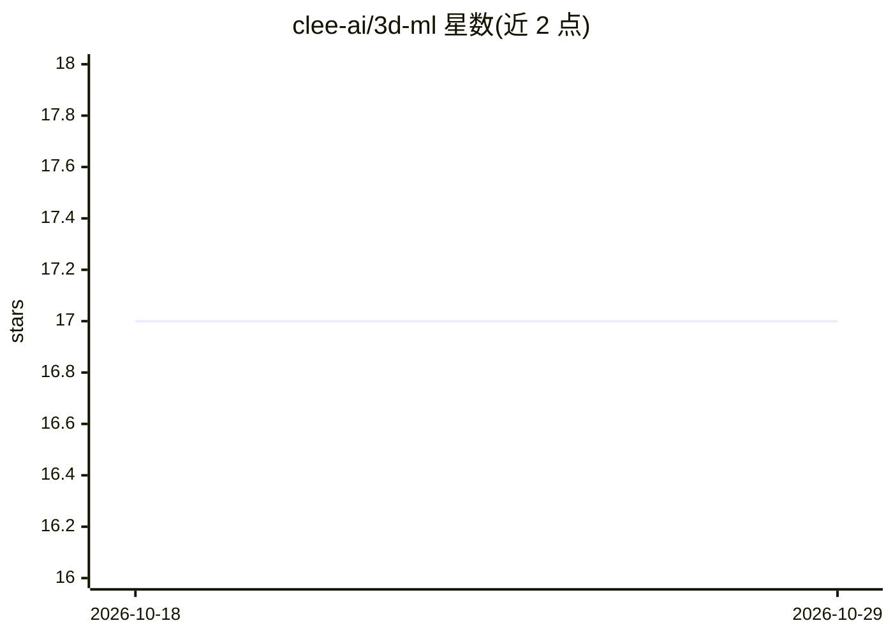

# clee-ai/3d-ml

⭐ 17 · Python · 推送 2026-10-19 · [GitHub](https://github.com/clee-ai/3d-ml) · 组织维护

**基于 PyTorch Lightning 与 Hydra 的 3D 机器学习训练框架**

面向点云等 3D 数据的深度学习训练框架：以插件式架构连接 TorchSparse、OpenPoints 等下游模型实现库，通过 Hydra 管理实验配置（命令行覆盖任意参数、超参 sweep、Optuna 搜索），支持 CPU/GPU/多 GPU/TPU 与混合精度训练，集成 W&B、Tensorboard 等多种日志后端。提供 PointNet++ 等参考实现，数据集继承 torch_geometric Dataset，含分类与分割任务模板。通过 conda 或 pip 从源码克隆安装，README 注明正在征求贡献者。

## 筛选速览

| 维度 | 判定 | 备注 |
|---|---|---|
| AI 角色 | `ai-native` | 本体是模型或模型工具 |
| 许可风险 | `none` | — |
| 部署形态 | `library` | 以包/库形式分发 |
| 模型依赖 | — | README 未给出锁定关系 |
| 硬件要求 | — | 无带数字的原话,不猜 |
| 安装摩擦 | `low` | 无编译、无系统依赖或容器化 |
| 成熟度 | — | 结构信号不足 |

## 能力要点

- Hydra 配置驱动的实验管理：命令行覆盖、多 seed、超参 sweep 与 Optuna 搜索
- 插件式后端架构，封装 TorchSparse/OpenPoints 等下游模型库
- 支持 CPU/GPU/多 GPU/TPU 训练与混合精度
- 集成 W&B/Tensorboard/MLFlow 等多种实验跟踪工具

## 适用场景

- 我在 3D 点云数据上训练分类或分割模型并跟踪实验
- 我用统一配置在多个数据集（如 S3DIS、ModelNet）间切换实验
- 我需要做超参数搜索并版本化管理最优实验配置

## 场景标签

`目标检测` `模型训练` · 领域:感知与多模态

## 证据(README 行号)

> L8: **A versatile framework for 3D machine learning built on Pytorch Lightning and Hydra.**
> L35: python src/train.py model=cls_pointnet++ data=cls_modelnet2048

## 星数曲线

2026-10-18 17 → 2026-10-29 17（+0）

---
*卡片 v1 · prompt 1.4 · 生成 2026-10-29 · 置信度 high · 依据 README sha `d075f7581269` · [字段定义](../../DATASET.md)*
