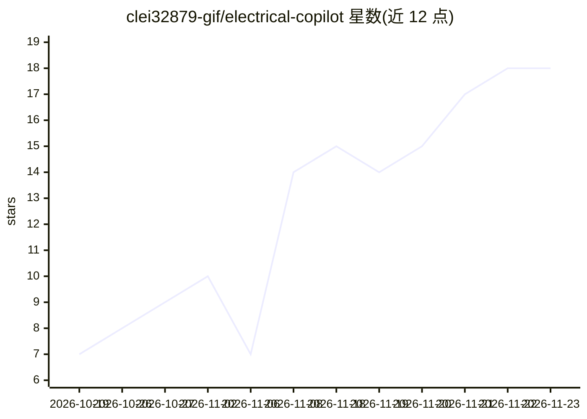

# clei32879-gif/electrical-copilot

⭐ 18 · Python · NOASSERTION · 推送 2026-09-14 · [GitHub](https://github.com/clei32879-gif/electrical-copilot) · 个人维护 · 中文 README

**本地运行的电气工程师 AI 工作台：直出多品牌 PLC 工程文件**

面向电气工程师的本地 Web 应用（FastAPI + 原生 JS 前端），通过 OpenAI 兼容接口接入任意 LLM（DeepSeek/智谱/Kimi/通义/本地 Ollama）。核心能力：AI 由中文需求编写梯形图并生成信捷 .xdp、三菱/西门子/松下/汇川/台达等品牌可导入的工程文件（信捷 .xdp 为逆向 XML 生成，真机验证；部分品牌走官方导入通道未逐一装机验证）；梯形图模拟器、电气图理解与设计（输出 DXF）、智能选型、40 个案例库与 10 份项目材料包交付。README 明确声明 AI 生成程序须持证工程师复核，安全逻辑不可直接上线。

## 筛选速览

| 维度 | 判定 | 备注 |
|---|---|---|
| AI 角色 | `ai-native` | 本体是模型或模型工具 |
| 许可风险 | `none` | NOASSERTION |
| 部署形态 | `library` | 以包/库形式分发 |
| 模型依赖 | local-ok | 支持本地模型 |
| 硬件要求 | — | 无带数字的原话,不猜 |
| 安装摩擦 | `low` | 无编译、无系统依赖或容器化 |
| 成熟度 | `idea` | |

## 能力要点

- 中文需求直出 7 类品牌 PLC 工程文件（信捷 .xdp 双击可用 XDPPro 打开）
- 网页梯形图模拟器：实时仿真 X/Y/M/D/T/C 状态与扫描周期
- 需求访谈生成 10 份材料包（方案书/IO 表/BOM/接线图 DXF/PLC 程序等）
- 200+ 篇品牌知识库按品牌自动注入，40 个实战案例

## 适用场景

- 用中文描述控制需求，直接拿到能在编程软件中打开的 PLC 工程
- 上传梯形图截图或电气原理图照片，获得逐行解释与问题诊断
- 做方案阶段选型计算与项目材料包编制
- 用网页模拟器验证梯形图逻辑后再下载到设备

## 场景标签

`代码生成` · 领域:编码与开发

## 证据(README 行号)

> L14: |**AI 编写梯形图 → 直出工程文件**|一句话描述需求，产出**能用 XDPPro / GX Works2 / 博途 / Pro7 / AutoShop / ISPSoft 打开或粘贴**的工程文件，不是文本说明|
> L52: 界面右上角「⚙ 模型设置」填入任意 **OpenAI 兼容**接口即可：
> L82: ## PLC 工程文件直出（重点）

## 星数曲线

2026-10-19 7 → 2026-11-23 18（+11）

---
*卡片 v1 · prompt 1.4 · 生成 2026-11-18 · 置信度 high · 依据 README sha `d411609b026e` · [字段定义](../../DATASET.md)*
