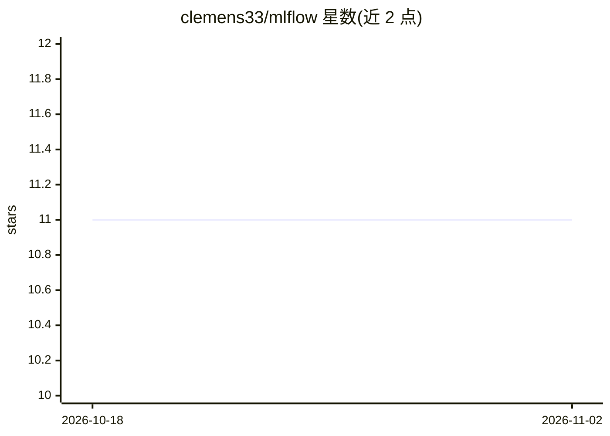

# clemens33/mlflow

⭐ 11 · Shell · MIT · 推送 2026-10-21 · [GitHub](https://github.com/clemens33/mlflow) · 个人维护

**MLflow 实验与产物追踪服务器的容器化自托管部署配置**

为 MLflow 追踪服务器提供多种部署方式的工程配置仓库：poetry 本地运行、Docker 镜像构建、docker compose 与 Kubernetes Helm Chart。后端支持 PostgreSQL（仅 psycopg2），产物存储支持 S3（含代理模式，客户端无需凭证）与 Azure Blob Storage，指标可暴露 Prometheus，并提供 MLflow 3.5+ 的安全中间件（allowed-hosts/CORS）Kubernetes 配置示例。另含 MLflow deployments server 的启动配置与 completions/embeddings/chat 示例脚本。

## 筛选速览

| 维度 | 判定 | 备注 |
|---|---|---|
| AI 角色 | `ai-ecosystem` | LLM/agent 周边工具 |
| 许可风险 | `permissive` | MIT |
| 部署形态 | `self-host` | docker 或自建部署 |
| 模型依赖 | — | README 未给出锁定关系 |
| 硬件要求 | — | 无带数字的原话,不猜 |
| 安装摩擦 | `low` | 无编译、无系统依赖或容器化 |
| 成熟度 | — | 结构信号不足 |

## 能力要点

- 提供 Docker 镜像构建、docker compose 与 Kubernetes Helm Chart 部署配置
- 后端存储支持 PostgreSQL（仅 psycopg2）
- 产物存储支持 S3 与 Azure Blob Storage，含代理模式隔离客户端凭证
- 支持 Prometheus 指标暴露与 MLflow deployments server 启动配置

## 适用场景

- 自托管 MLflow 实验追踪与产物存储服务
- 在 Kubernetes 集群中部署 MLflow 服务器
- 通过代理模式让客户端无需接触 S3/Azure 凭证即可读写产物

## 场景标签

`MLOps` · 领域:训练与推理

## 证据(README 行号)

> L3: Setup focuses on experiment and artifact tracking using mlflow.
> L7: Requires poetry, docker and docker compose.
> L170: Starting from MLflow 3.5+, the server defaults to uvicorn and includes security middleware for DNS rebinding and C

## 星数曲线

2026-10-18 11 → 2026-11-02 11（+0）

---
*卡片 v1 · prompt 1.4 · 生成 2026-11-02 · 置信度 high · 依据 README sha `2f964fd40568` · [字段定义](../../DATASET.md)*
