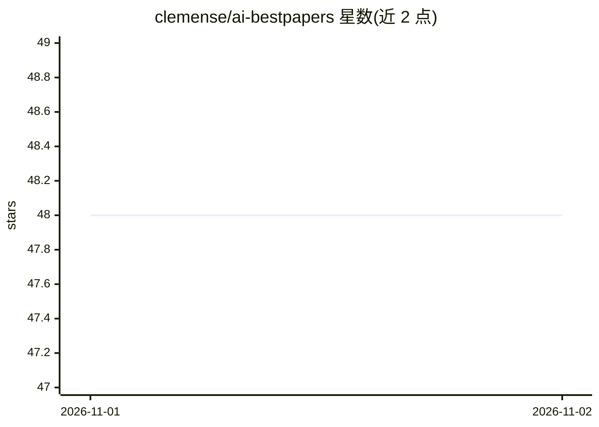

# clemense/ai-bestpapers

⭐ 48 · HTML · MIT · 推送 2026-10-31 · [GitHub](https://github.com/clemense/ai-bestpapers) · [官网](http://www.aibestpape.rs) · 个人维护

**各 AI 相关会议最佳论文获奖清单**

收录 Robotics/AI/ML/CV/NLP/CG 等领域会议的获奖论文列表，条目按来源会议组织，基于 aideadlin.es 项目构建，以 GitHub 仓库形式维护并接受社区贡献。属于学术资源聚合类清单，不提供代码运行或模型功能，供研究者检索获奖论文线索使用。README 信息有限，未提供安装或使用流程。

## 筛选速览

| 维度 | 判定 | 备注 |
|---|---|---|
| AI 角色 | `ai-knowledge` | 知识聚合/清单类 |
| 许可风险 | `permissive` | MIT |
| 部署形态 | `None` |  |
| 模型依赖 | — | README 未给出锁定关系 |
| 硬件要求 | — | 无带数字的原话,不猜 |
| 安装摩擦 | `low` | 无编译、无系统依赖或容器化 |
| 成熟度 | — | 结构信号不足 |

## 能力要点

- 收录多个领域会议的获奖论文
- 基于 aideadlin.es 项目构建
- MIT 许可，接受社区贡献

## 适用场景

- 查找机器人/AI/ML/CV/NLP/CG 领域会议的获奖论文
- 了解各会议历年被表彰的研究方向

## 场景标签

`精选清单` · 领域:学习与行业

## 证据(README 行号)

> L3: List of awarded papers from Robotics/AI/ML/CV/NLP/CG venues.

## 星数曲线

2026-11-01 48 → 2026-11-02 48（+0）

---
*卡片 v1 · prompt 1.4 · 生成 2026-10-31 · 置信度 mid · 依据 README sha `9052dcba9af4` · [字段定义](../../DATASET.md)*
