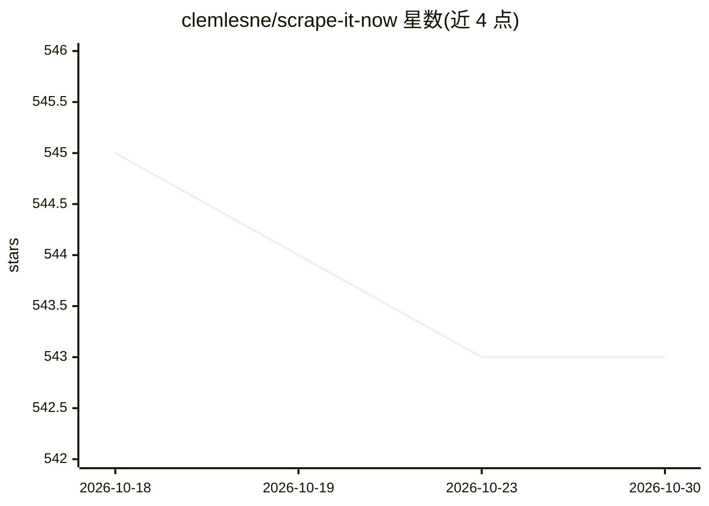

# clemlesne/scrape-it-now

⭐ 543 · Python · Apache-2.0 · 推送 2025-11-03 · [GitHub](https://github.com/clemlesne/scrape-it-now) · 个人维护

**面向 AI 管线的可并行网页爬虫 CLI，输出 markdown 并建立语义索引**

Python CLI 网页爬虫，分 scrape 与 index 两阶段：爬取阶段用 Playwright/Chromium 加载动态内容、Pandoc 抽取 markdown 与元数据、拦截广告、去重链接、保存图片与截图；索引阶段将 markdown 分块后用 Azure OpenAI embeddings 向量化，写入 Azure AI Search 供语义检索。架构上队列与存储支持 Azure Queue/Blob Storage 或本地 sqlite/磁盘，操作幂等可并行，可用多个容器扩展。爬虫本体非 AI，AI 用于嵌入索引环节。

## 筛选速览

| 维度 | 判定 | 备注 |
|---|---|---|
| AI 角色 | `ai-ecosystem` | LLM/agent 周边工具 |
| 许可风险 | `permissive` | Apache-2.0 |
| 部署形态 | `library` | 以包/库形式分发 |
| 模型依赖 | locked-api |  |
| 硬件要求 | — | 无带数字的原话,不猜 |
| 安装摩擦 | `low` | 无编译、无系统依赖或容器化 |
| 成熟度 | — | 结构信号不足 |

## 能力要点

- 并行幂等任务，队列/存储可选 Azure 或本地磁盘（sqlite 队列）
- Playwright/Chromium 渲染动态页面，Pandoc 转 markdown，保存图片与截图
- 索引阶段分块并用 Azure OpenAI embeddings 写入 Azure AI Search
- Chromium 浏览器二进制运行时自动下载（约 450MB），可用 scrape install 预下载

## 适用场景

- 为 RAG/LLM 应用批量准备网站 markdown 语料
- 将爬取内容分块嵌入并写入 Azure AI Search 做语义搜索
- 本地磁盘模式下小规模测试爬取与索引流程

## 场景标签

`网页抓取` `语义搜索` · 领域:效率与自动化

## 证据(README 行号)

> L3: Web scraper made for AI and simplicity in mind. It runs as a CLI that can be parallelized and outputs high-quality m
> L36: - 📈 Embed chunks with OpenAI embeddings
> L37: - 🔍 Indexed content is semantically searchable with Azure AI Search

## 星数曲线

2026-10-18 545 → 2026-10-30 543（-2）

---
*卡片 v1 · prompt 1.4 · 生成 2026-10-21 · 置信度 high · 依据 README sha `7c3debd69862` · [字段定义](../../DATASET.md)*
