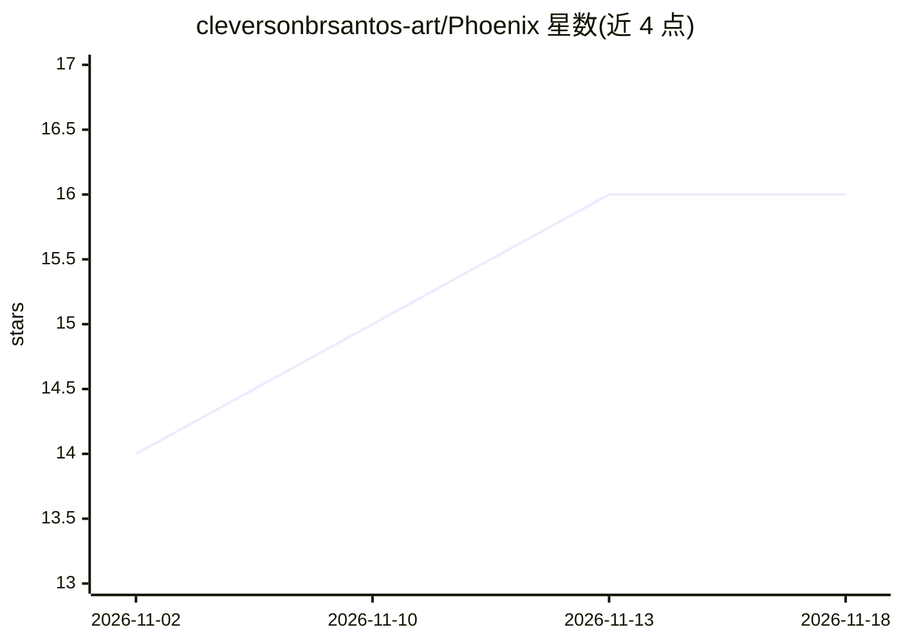

# cleversonbrsantos-art/Phoenix

⭐ 16 · TypeScript · 推送 2026-09-08 · [GitHub](https://github.com/cleversonbrsantos-art/Phoenix) · 个人维护

**本地优先的持久认知 AI 助手，配书出版的完整实现**

书籍《Building Persistent AI》的配套代码库：一个本地优先的 AI 助手，记忆、身份与情绪状态存于本地 SQLite，不依赖 LLM 维持，可跨模型更换与重启存续。核心机制包括五 Agent 流水线（记忆→规划→行动→反思→人格）、黑板架构、PAD 情绪引擎、空闲时的 Daydream 反思进程、休息期记忆固化的潜意识周期与 +/− 反馈强化学习。运行需 Node.js 18+ 与免费 Gemini API key，可在无 GPU 的普通笔记本上运行；作者声明非生产级、无认证、不支持多用户部署。

## 筛选速览

| 维度 | 判定 | 备注 |
|---|---|---|
| AI 角色 | `ai-native` | 本体是模型或模型工具 |
| 许可风险 | `none` | — |
| 部署形态 | `None` |  |
| 模型依赖 | — | README 未给出锁定关系 |
| 硬件要求 | — | 无带数字的原话,不猜 |
| 安装摩擦 | `low` | 无编译、无系统依赖或容器化 |
| 成熟度 | — | 结构信号不足 |

## 能力要点

- 记忆/身份/情绪持久化于本地 SQLite，跨模型更换与重启存续
- 五 Agent 顺序流水线与黑板架构
- PAD 情绪引擎与 Daydream/潜意识周期的反思与记忆固化
- +/− 用户反馈接入内部强化评分系统

## 适用场景

- 跟随配套书籍学习持久认知架构的实现
- 在普通笔记本上运行有持久记忆与情绪状态的个人 AI 助手
- 研究记忆固化、反思机制等认知架构设计

## 场景标签

`AI 助手` `Agent 记忆` · 领域:Agent 开发

## 证据(README 行号)

> L17: Phoenix V2 is a local-first AI assistant with a persistent cognitive architecture. It does not rely on the LLM to m
> L26: |Multi-Agent Pipeline|Five specialized agents (Memory → Planning → Action → Reflection → Personality) process each 

## 星数曲线

2026-11-02 14 → 2026-11-18 16（+2）

---
*卡片 v1 · prompt 1.4 · 生成 2026-11-18 · 置信度 high · 依据 README sha `ca442ebd757a` · [字段定义](../../DATASET.md)*
