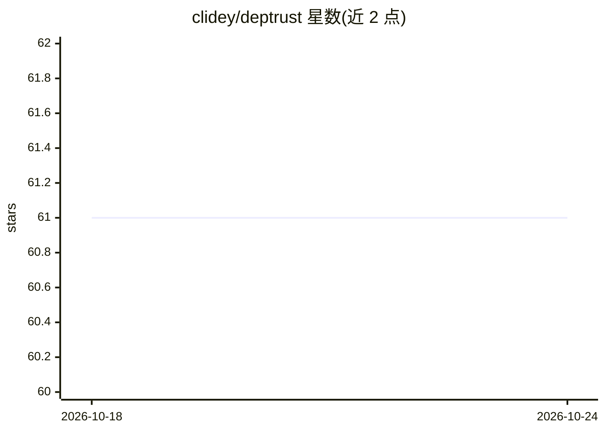

# clidey/deptrust

⭐ 61 · Go · MIT · 推送 2026-10-22 · [GitHub](https://github.com/clidey/deptrust) · 组织维护

**为 AI agent 服务的依赖漏洞检查 CLI 与 MCP 服务器**

deptrust 是本地运行的 CLI，检查 13+ 包生态（npm、PyPI、crates.io、Go、RubyGems、NuGet、Maven 等）中指定包版本的已知漏洞，并行查询 OSV 与 GitHub Advisory Database，输出 block/review/allow 建议与风险分，并提供 JSON 输出、版本建议与两版本比较。同时以 MCP 服务器形式接入 Codex 与 Claude Code，通过 PreToolUse 钩子在 agent 安装依赖或修改 GitHub Actions 前拦截。无托管服务，直接调用公共 registry 与 OSV API。

## 筛选速览

| 维度 | 判定 | 备注 |
|---|---|---|
| AI 角色 | `ai-ecosystem` | LLM/agent 周边工具 |
| 许可风险 | `permissive` | MIT |
| 部署形态 | `library` | 以包/库形式分发 |
| 模型依赖 | — | README 未给出锁定关系 |
| 硬件要求 | — | 无带数字的原话,不猜 |
| 安装摩擦 | `low` | 无编译、无系统依赖或容器化 |
| 成熟度 | — | 结构信号不足 |

## 能力要点

- 覆盖 13+ 包生态，并行查询 OSV 与 GitHub Advisory DB
- 按最高严重度输出 block/review/allow 建议与风险分
- 以 MCP 服务器与 PreToolUse 钩子接入 Codex / Claude Code，安装前拦截依赖
- 72 小时内新发布版本标记 review 的风险信号

## 适用场景

- AI agent 推荐或安装依赖前自动核验漏洞
- CI 中对包版本做漏洞检查并输出 JSON
- 让 agent 回答"哪些依赖可安全升级"前先过检

## 场景标签

`网络安全` · 领域:学习与行业

## 证据(README 行号)

> L14: It runs locally as a CLI and as an MCP server. It calls public package registry and OSV APIs directly; there is no 
> L294: The hooks are `PreToolUse` hooks. They check package install commands before they run, and they also check GitHub 
> L309: After MCP setup, agents will automatically check packages before recommending updates or changes. The MCP server s

## 星数曲线

2026-10-18 61 → 2026-10-24 61（+0）

---
*卡片 v1 · prompt 1.4 · 生成 2026-10-24 · 置信度 mid · 依据 README sha `4a29307490fc` · [字段定义](../../DATASET.md)*
