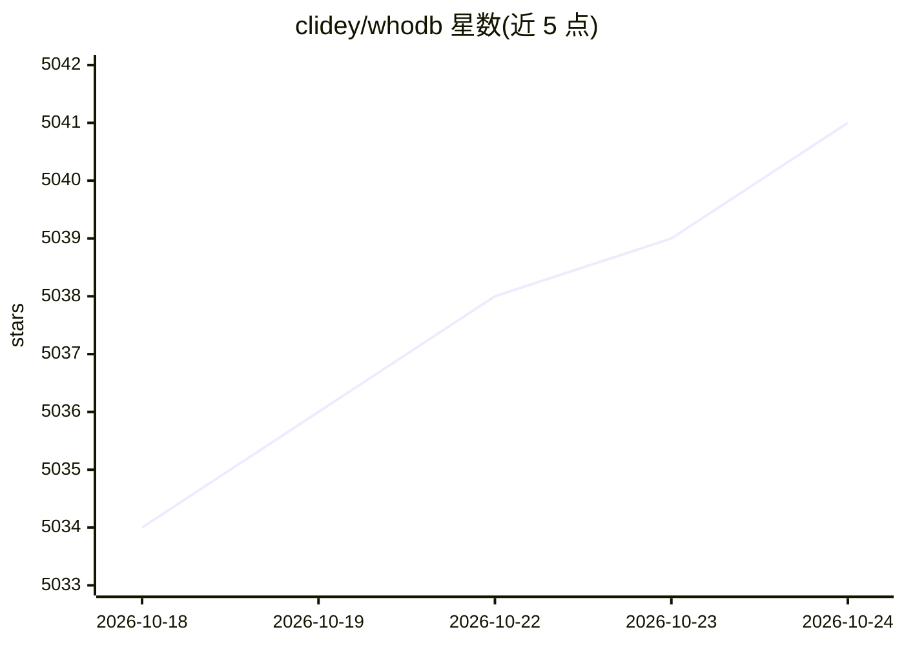

# clidey/whodb

⭐ 5,041 · Go · Apache-2.0 · 推送 2026-10-24 · [GitHub](https://github.com/clidey/whodb) · [官网](https://whodb.com) · 组织维护

**自托管轻量数据库工作台，浏览/查询/编辑多种数据库**

WhoDB Community 是 Apache-2.0 许可的自托管数据库工作区：在浏览器中提供表格化数据浏览与内联编辑、表关系图、带自动补全与历史的查询草稿本、导入导出与 mock 数据生成，支持 PostgreSQL、MySQL、SQLite、MongoDB、Redis、ClickHouse 等 20 余种数据源。可经 Docker、桌面应用（macOS/Windows/Snap）或 CLI 使用，CLI 内含 MCP server 供 AI 工具调用。AI 功能为可选：可接入 Ollama、OpenAI、Anthropic、LM Studio 等用自然语言提问。另有商业版 WhoDB Platform 提供 SSO、审计日志、管道等企业功能。

## 筛选速览

| 维度 | 判定 | 备注 |
|---|---|---|
| AI 角色 | `ai-enhanced` | 去掉 AI 部分产品仍成立 |
| 许可风险 | `permissive` | Apache-2.0 |
| 部署形态 | `self-host` | docker 或自建部署 |
| 模型依赖 | local-ok | 支持本地模型 |
| 硬件要求 | — | 无带数字的原话,不猜 |
| 安装摩擦 | `low` | 无编译、无系统依赖或容器化 |
| 成熟度 | — | 结构信号不足 |

## 能力要点

- 表格化数据浏览、内联编辑与可视化表关系图
- 支持 20 余种数据库（PostgreSQL/MySQL/SQLite/MongoDB/Redis/ClickHouse 等）
- CLI 内含终端 UI 与 MCP server，供 AI 工具连接
- AI 提供商为可选项，支持 Ollama/LM Studio 本地与 OpenAI/Anthropic/Gemini 托管

## 适用场景

- 免装重型客户端，快速检查和浏览本地数据库
- 帮同事探索不熟悉的数据库结构与数据
- 通过自然语言向数据库提问（接入自选 AI 提供商）
- 在 AI 工具中经 MCP server 操作数据库

## 场景标签

`数据分析` · 领域:效率与自动化

## 证据(README 行号)

> L36: WhoDB gives you one place to explore your databases, edit data, run queries, and understand how a schema fits toget
> L38: Use it when you want to inspect a local database, help a teammate explore unfamiliar data, or work without installi

## 星数曲线

2026-10-18 5,034 → 2026-10-24 5,041（+7）

---
*卡片 v1 · prompt 1.4 · 生成 2026-10-20 · 置信度 high · 依据 README sha `e0837ff8b1e8` · [字段定义](../../DATASET.md)*
