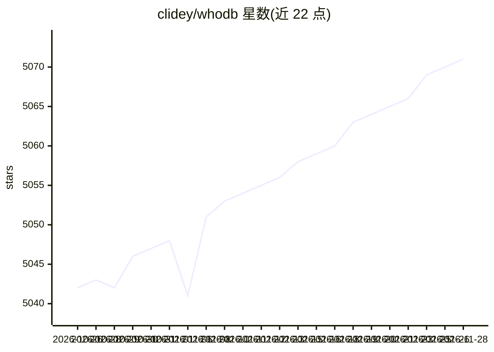

# clidey/whodb

⭐ 5,071 · Go · Apache-2.0 · 推送 2026-11-27 · [GitHub](https://github.com/clidey/whodb) · [官网](https://whodb.com) · 组织维护

**自托管的数据库管理工作台：浏览、编辑、查询与可视化 schema**

WhoDB 是一个轻量自托管数据库工作区，支持 PostgreSQL、MySQL、MongoDB、Redis、ClickHouse 等多类数据源的浏览编辑、SQL 查询草稿本、交互式 schema 关系图、数据导入导出与 mock 数据生成。提供 Docker、桌面应用、CLI 与 MCP server 多种形态；AI 功能为可选项，可接入 Ollama、OpenAI、Anthropic、LM Studio 或 OpenAI 兼容服务以自然语言提问。商业版 Platform 提供组织级功能。

## 筛选速览

| 维度 | 判定 | 备注 |
|---|---|---|
| AI 角色 | `ai-enhanced` | 去掉 AI 部分产品仍成立 |
| 许可风险 | `permissive` | Apache-2.0 |
| 部署形态 | `self-host` | docker 或自建部署 |
| 模型依赖 | local-ok | 支持本地模型 |
| 硬件要求 | — | 无带数字的原话,不猜 |
| 安装摩擦 | `low` | 无编译、无系统依赖或容器化 |
| 成熟度 | — | 结构信号不足 |

## 能力要点

- 支持 PostgreSQL、MySQL、MongoDB、Redis、ClickHouse 等 20+ 种数据源
- 表格网格内联编辑、查询草稿本与交互式 schema 图
- CLI 内置 MCP server 供 AI 工具调用
- 可选接入 Ollama/LM Studio 等本地或托管 AI 供应商

## 适用场景

- 自托管一个轻量数据库客户端替代重型工具
- 帮同事可视化探索陌生数据库的表关系
- 通过自然语言向数据库提问
- 为 AI 工具提供数据库访问的 MCP server

## 场景标签

`数据分析` · 领域:效率与自动化

## 证据(README 行号)

> L36: WhoDB gives you one place to explore your databases, edit data, run queries, and understand how a schema fits toget
> L38: Use it when you want to inspect a local database, help a teammate explore unfamiliar data, or work without installi

## 星数曲线

2026-10-26 5,042 → 2026-11-28 5,071（+29）

---
*卡片 v1 · prompt 1.4 · 生成 2026-11-27 · 置信度 high · 依据 README sha `fe8c2c75847b` · [字段定义](../../DATASET.md)*
