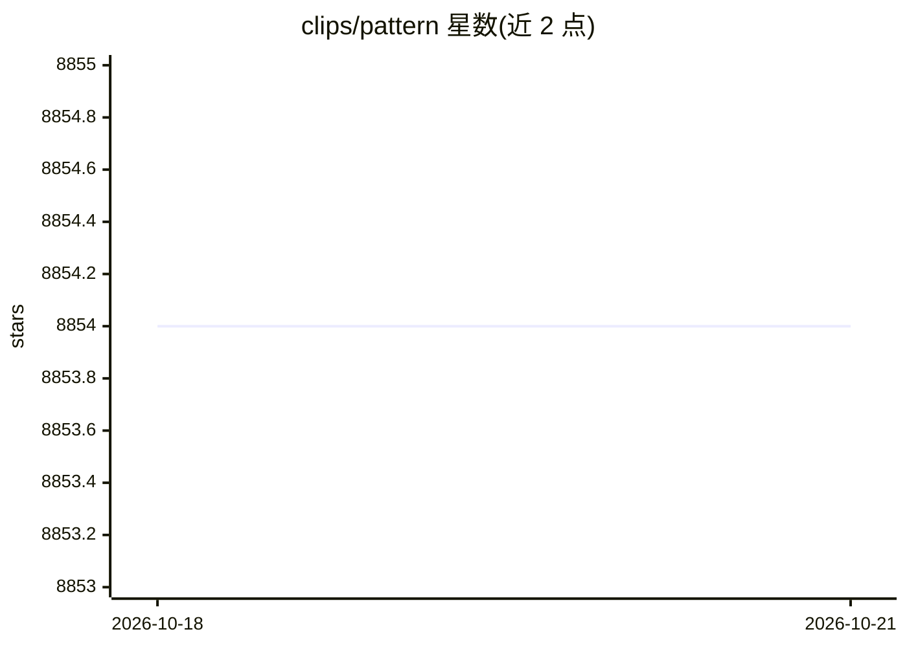

# clips/pattern

⭐ 8,854 · Python · BSD-3-Clause · 推送 2026-08-05 · [GitHub](https://github.com/clips/pattern) · [官网](https://github.com/clips/pattern/wiki) · 组织维护

**Python 网络挖掘库：抓取、NLP、机器学习与网络分析工具集**

面向 Python 开发者的网络挖掘模块，涵盖四类工具：数据挖掘（Google/Twitter/Wikipedia 等网络服务接口、爬虫、HTML DOM 解析）、自然语言处理（多语言词性标注、n-gram 搜索、情感分析、WordNet）、机器学习（向量空间模型、聚类、KNN/SVM/Perceptron 分类）以及图中心性网络分析与可视化。内置 350+ 单元测试与 50+ 示例，捆绑多语言 Brill 标注器与 LIBSVM 等组件，BSD 许可。注意：仓库已归档，不再维护。

## 筛选速览

| 维度 | 判定 | 备注 |
|---|---|---|
| AI 角色 | `ai-native` | 本体是模型或模型工具 |
| 许可风险 | `permissive` | BSD-3-Clause |
| 部署形态 | `library` | 以包/库形式分发 |
| 模型依赖 | — | README 未给出锁定关系 |
| 硬件要求 | — | 无带数字的原话,不猜 |
| 安装摩擦 | `low` | 无编译、无系统依赖或容器化 |
| 成熟度 | — | 结构信号不足 |

## 能力要点

- 内置 Google/Twitter/Wikipedia 网络服务接口与网页爬虫
- 多语言词性标注、情感分析与 WordNet 工具
- 向量空间模型与 KNN/SVM/Perceptron 分类器
- 捆绑 350+ 单元测试与 50+ 示例

## 适用场景

- 抓取社交媒体文本并做情感分析
- 训练文本分类器（如按主题标签分类推文）
- 对抓取数据做图网络中心性分析与可视化

## 场景标签

`网页抓取` · 领域:效率与自动化

## 证据(README 行号)

> L17:  * Natural Language Processing: part-of-speech taggers, n-gram search, sentiment analysis, WordNet
> L18:  * Machine Learning: vector space model, clustering, classification (KNN, SVM, Perceptron)

## 星数曲线

2026-10-18 8,854 → 2026-10-21 8,854（+0）

---
*卡片 v1 · prompt 1.4 · 生成 2026-10-20 · 置信度 high · 依据 README sha `530d25dc2a86` · [字段定义](../../DATASET.md)*
