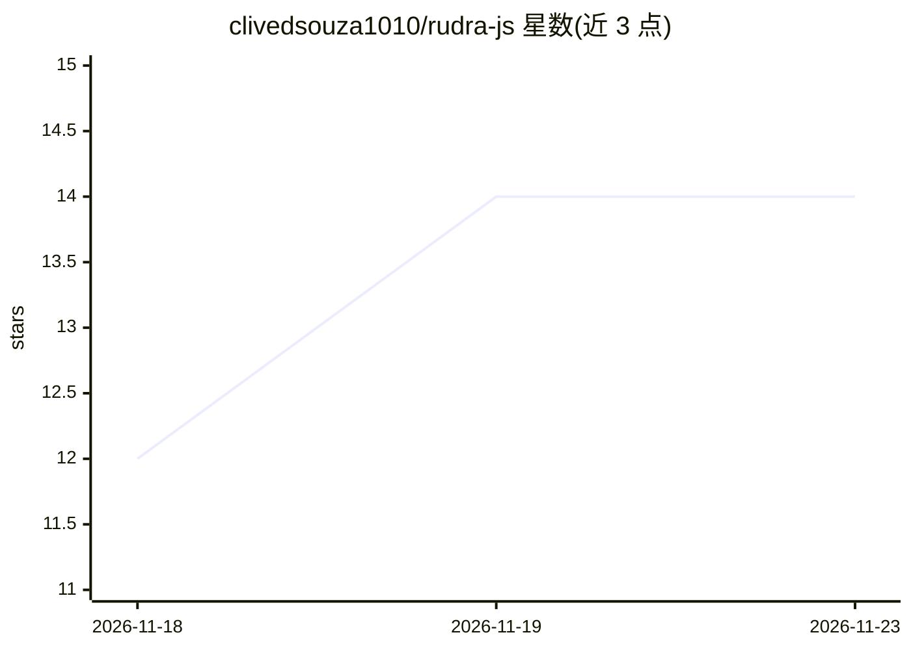

# clivedsouza1010/rudra-js

⭐ 14 · TypeScript · MIT · 推送 2026-11-22 · [GitHub](https://github.com/clivedsouza1010/rudra-js) · [官网](https://rudrajs.com) · 个人维护

**让 LLM 设计推荐文案、以目录校验防编造的电商 React 推荐库**

TypeScript 库（MIT，多包组成）：LLM 仅输出受限的 spec（无价格/商品名/图片/链接字段，命名须用给定 SKU），@rudra-js/react 从目录读取真实数据渲染为服务端 HTML，无需客户端 JS。对模型文字做三道检查（价格/折扣模式、数字来源校验、无数字声明清单），未通过的字符段被丢弃。README 自述三道检查存在绕过缺口，结构约束才是主要防线。无 provider 时 core 可自行生成。0.9.1 早期版本，API 可能变动。

## 筛选速览

| 维度 | 判定 | 备注 |
|---|---|---|
| AI 角色 | `ai-native` | 本体是模型或模型工具 |
| 许可风险 | `permissive` | MIT |
| 部署形态 | `library` | 以包/库形式分发 |
| 模型依赖 | locked-api |  |
| 硬件要求 | — | 无带数字的原话,不猜 |
| 安装摩擦 | `low` | 无编译、无系统依赖或容器化 |
| 成熟度 | `idea` | |

## 能力要点

- 模型只写受限 spec，商品、价格、图片一律来自商家目录
- 三道输出校验（价格模式/数字来源/无数字声明），失败字段直接丢弃
- 默认模式每 1,000 页面浏览约 460 次模型调用（cohort 缓存）
- 推荐块在首个 HTML 响应内，不依赖客户端 JavaScript

## 适用场景

- 给自己的 Next.js 商店商品页生成个性化推荐块
- 防止 LLM 在推荐位编造价格或不存在的商品
- 构建 SEO 友好、爬虫可直接读取的推荐内容

## 场景标签

`推荐系统` · 领域:学习与行业

## 证据(README 行号)

> L3: rudra-js is an open-source TypeScript library for generating dynamic product recommendations.
> L13: return a spec instead: a short description of the block, made up only of fields rudra-js defines. It
> L63: You will need React 18 or 19, but not Server Components. `@rudra-js/react` is just plain React with

## 星数曲线

2026-11-18 12 → 2026-11-23 14（+2）

---
*卡片 v1 · prompt 1.4 · 生成 2026-11-18 · 置信度 high · 依据 README sha `104ee2036f22` · [字段定义](../../DATASET.md)*
