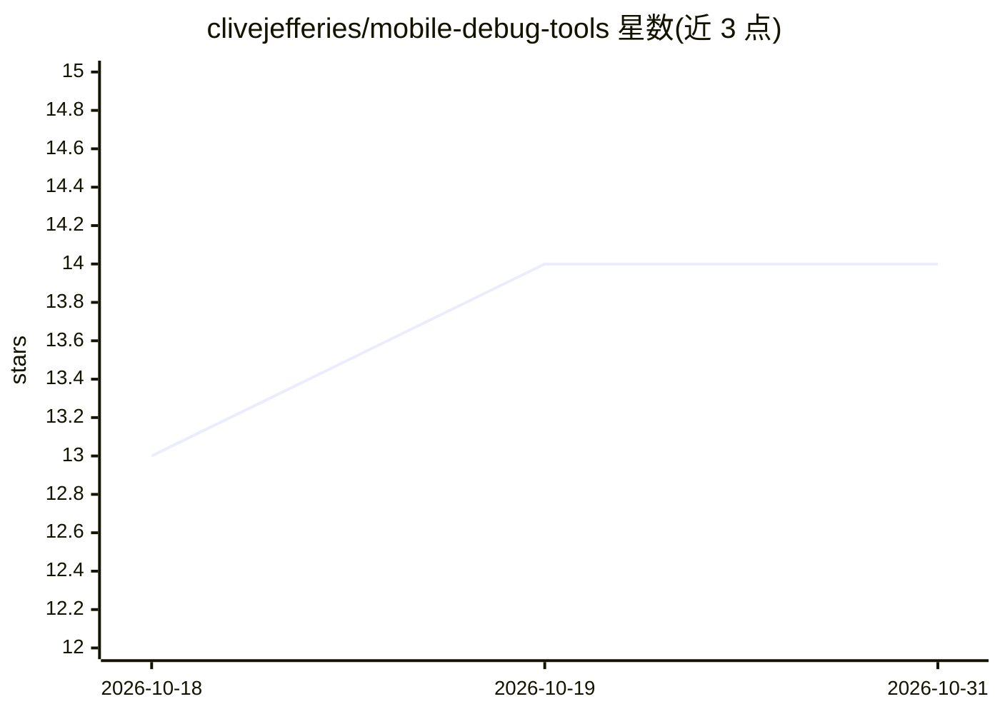

# clivejefferies/mobile-debug-tools

⭐ 14 · TypeScript · Apache-2.0 · 推送 2026-10-30 · [GitHub](https://github.com/clivejefferies/mobile-debug-tools) · 个人维护

**让 MCP 客户端/agent 操作 Android 与 iOS 设备的调试工具服务器**

MCP 服务器（stdio），把 MCP 客户端连接到本地移动设备工具链，提供构建/安装/启动应用、UI 操作（tap 等）、截图、UI 树读取、日志、状态断言，以及可选的 Android 性能采集与运行时调试。支持 Android、iOS 与 Kotlin Multiplatform 项目；Flutter 与 React Native 未测试。通过 npx 运行，需 Node.js 18+、Android SDK(adb)，iOS 需 Xcode 与 idb；另提供 Codex/Claude Code/Cursor 的 agent 插件安装方式。

## 筛选速览

| 维度 | 判定 | 备注 |
|---|---|---|
| AI 角色 | `ai-ecosystem` | LLM/agent 周边工具 |
| 许可风险 | `permissive` | Apache-2.0 |
| 部署形态 | `None` |  |
| 模型依赖 | — | README 未给出锁定关系 |
| 硬件要求 | — | 无带数字的原话,不猜 |
| 安装摩擦 | `low` | 无编译、无系统依赖或容器化 |
| 成熟度 | — | 结构信号不足 |

## 能力要点

- 跨 Android/iOS/KMP 的构建、安装、启动与 UI 操作 MCP 工具
- 截图、UI 树读取、元素可见性断言与日志采集
- 可选 Android 性能采集与运行时调试（需 JDK 17+）
- 支持 Codex/Claude Code/Cursor 插件市场安装

## 适用场景

- 在 MCP 客户端中远程构建安装并启动移动应用
- 通过 agent 执行 UI 操作并断言界面状态完成自动化验证
- 失败时采集截图与日志定位移动端问题

## 场景标签

 · 领域:移动开发/开发者工具

## 证据(README 行号)

> L4: Build, install, control, and inspect Android and iOS apps from an MCP-compatible
> L5: client. Mobile Debug MCP connects your client to local device toolchains and

## 星数曲线

2026-10-18 13 → 2026-10-31 14（+1）

---
*卡片 v1 · prompt 1.4 · 生成 2026-10-31 · 置信度 high · 依据 README sha `d00a0751deeb` · [字段定义](../../DATASET.md)*
