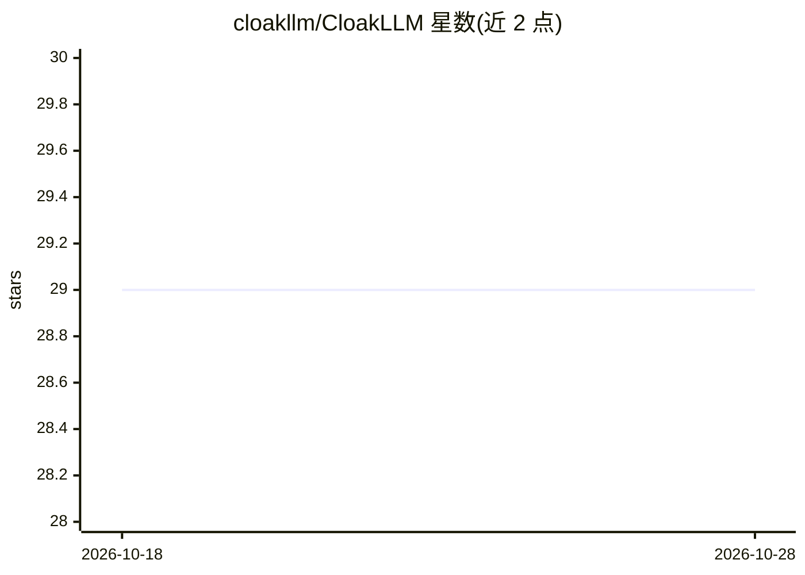

# cloakllm/CloakLLM

⭐ 29 · MIT · 推送 2026-10-09 · [GitHub](https://github.com/cloakllm/CloakLLM) · [官网](https://asciinema.org/a/odNEs0kWP51YRGtl) · 组织维护

**LLM 调用前的 PII 脱敏中间件，附防篡改审计日志**

面向 LLM 应用的隐私保护中间件：在 prompt 离开本地基础设施前检测 PII（邮箱、SSN、信用卡等），以可逆的 [CATEGORY_N] token 替换并保留上下文，支持 LLM（本地 Ollama）检测上下文相关 PII、GDPR 不可逆删除模式、哈希链防篡改审计日志与 Ed25519 加密证明，提供 EU AI Act 第 12/4a/50 条合规模式与 RFC 3161 可信时间戳。以 Python/JS SDK、MCP Server 及 Chrome 扩展（CloakLLM Guard）形式提供，可集成 OpenAI SDK、LiteLLM、Vercel AI SDK。限制：企业级 KMS/HSM 支持实验性且默认禁用；MCP 工具在 prompt 到达提供商之后才被调用，无法阻止初始 prompt 中的 PII。

## 筛选速览

| 维度 | 判定 | 备注 |
|---|---|---|
| AI 角色 | `ai-ecosystem` | LLM/agent 周边工具 |
| 许可风险 | `permissive` | MIT |
| 部署形态 | `library` | 以包/库形式分发 |
| 模型依赖 | local-ok | 支持本地模型 |
| 硬件要求 | — | 无带数字的原话,不猜 |
| 安装摩擦 | `low` | 无编译、无系统依赖或容器化 |
| 成熟度 | `idea` | |

## 能力要点

- 可逆 tokenization 与 GDPR 不可逆删除模式
- 哈希链审计日志 + Ed25519 签名证书，对应 EU AI Act 第 12 条
- 可选本地 Ollama 检测上下文相关 PII 与自定义语义类别
- 13 种语言的 PII 检测模式与跨请求 HMAC-SHA256 实体哈希

## 适用场景

- LLM 应用发送 prompt 前自动脱敏用户敏感数据
- 为 EU AI Act 合规审计留存防篡改日志与合规报告
- 通过 MCP 在 Claude Desktop/Cursor 中调用脱敏工具

## 场景标签

`网络安全` · 领域:学习与行业

## 证据(README 行号)

> L13: Open-source PII protection middleware for LLMs. Detect sensitive data, replace it with reversible tokens, and maint
> L55: - **Middleware Integration** — drop-in support for LiteLLM and OpenAI SDK (Python) and OpenAI/Vercel AI SDK (JS)

## 星数曲线

2026-10-18 29 → 2026-10-28 29（+0）

---
*卡片 v1 · prompt 1.4 · 生成 2026-10-26 · 置信度 high · 依据 README sha `627729727337` · [字段定义](../../DATASET.md)*
