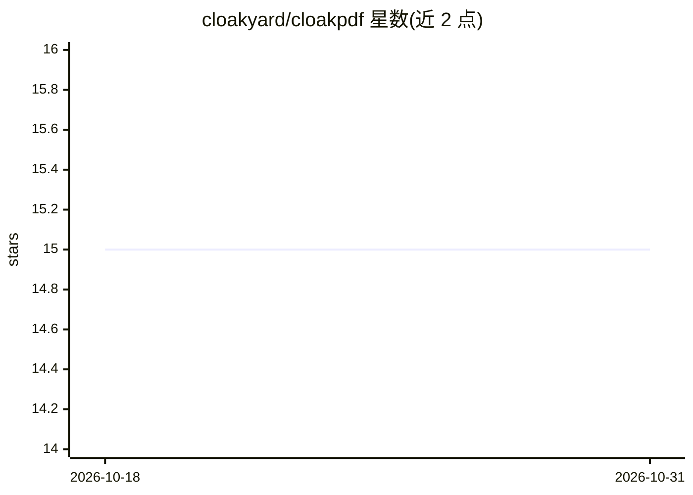

# cloakyard/cloakpdf

⭐ 15 · TypeScript · MIT · 推送 2026-10-30 · [GitHub](https://github.com/cloakyard/cloakpdf) · [官网](https://pdf.cloakyard.com) · 个人维护

**完全在浏览器本地运行的隐私优先 PDF 编辑工具箱**

纯客户端 Web/PDF 工具：单文档画布编辑器含 22 个编辑工具，覆盖批注签名、页面整理、涂黑脱敏、水印编号、OCR 等，另有合并转换、加密签证书、双文档对比等 7 个独立工具。隐私机制为无上传、无服务器、无追踪，PWA 可离线。AI 部分为 Ask your PDF：基于 Transformers.js 与 LangGraph 在浏览器内运行 RAG 问答，模型权重从 Hugging Face 下载一次后离线可用，无需 API key。技术栈 React 19 + TypeScript + Vite+。

## 筛选速览

| 维度 | 判定 | 备注 |
|---|---|---|
| AI 角色 | `ai-enhanced` | 去掉 AI 部分产品仍成立 |
| 许可风险 | `permissive` | MIT |
| 部署形态 | `library` | 以包/库形式分发 |
| 模型依赖 | — | README 未给出锁定关系 |
| 硬件要求 | — | 无带数字的原话,不猜 |
| 安装摩擦 | `low` | 无编译、无系统依赖或容器化 |
| 成熟度 | — | 结构信号不足 |

## 能力要点

- 22 个编辑工具 + 7 个独立工具，覆盖批注、脱敏、OCR、Bates 编号等
- 纯客户端运行：无上传、无服务器、无追踪，PWA 离线可用
- Ask your PDF：浏览器内 RAG 问答，模型下载一次后离线运行，无需 API key
- 压力感应手写签名（Apple Pencil/Wacom/S-Pen）与 ⌘K 命令面板

## 适用场景

- 处理含敏感信息的 PDF 且不希望文件离开设备
- 填写、签名并批注打印表单或合同
- 涂黑脱敏、清理隐藏数据与元数据后交付文档
- 离线向 PDF 文档提问获取回答

## 场景标签

`OCR` `文档问答` · 领域:知识与检索

## 证据(README 行号)

> L14: Drop a PDF and it opens in a single, canvas-based **editor** — a Photoshop-like workspace for one document at a tim
> L29: - **🤖 On-device AI** — _Ask your PDF_: chat with a document using a small model that runs entirely in your browser,
> L33: Everything runs client-side — there is no server to upload to. No accounts, no analytics, no tracking. It's an inst

## 星数曲线

2026-10-18 15 → 2026-10-31 15（+0）

---
*卡片 v1 · prompt 1.4 · 生成 2026-10-30 · 置信度 mid · 依据 README sha `f504facc91b1` · [字段定义](../../DATASET.md)*
