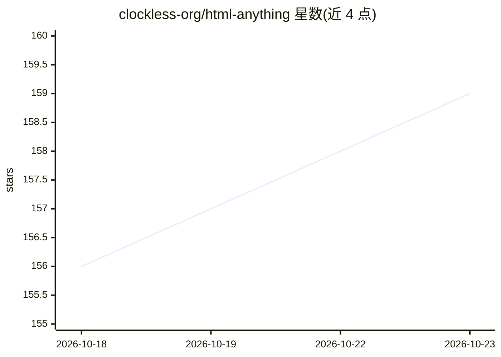

# clockless-org/html-anything

⭐ 159 · JavaScript · MIT-0 · 推送 2026-05-13 · [GitHub](https://github.com/clockless-org/html-anything) · 组织维护

**把任意文件/回答转为单文件交互 HTML 页面的 agent 技能**

面向 Codex、Claude Code 等 CLI/编辑器 agent 的技能包（SKILL.md + prompts/）：读取 PDF、CSV、DOCX、聊天导出、日志、URL 或文件夹等来源，按 60 个来源提示与 17 个具体风格系统自动路由，生成可分享的单文件 HTML 页面（需要本地资源时输出 output.html + assets/）。每个非 fallback 风格带在线示例与截图预览。通过 npx skills add 或 git clone 安装到 agent 技能目录，claude.ai 网页端需 Pro/Max/Team/Enterprise 并开启代码执行；不适用于 ChatGPT 自定义 GPT 与 Gemini Gems 格式。

## 筛选速览

| 维度 | 判定 | 备注 |
|---|---|---|
| AI 角色 | `ai-ecosystem` | LLM/agent 周边工具 |
| 许可风险 | `permissive` | MIT-0 |
| 部署形态 | `desktop` | 安装包/桌面程序 |
| 模型依赖 | — | README 未给出锁定关系 |
| 硬件要求 | — | 无带数字的原话,不猜 |
| 安装摩擦 | `low` | 无编译、无系统依赖或容器化 |
| 成熟度 | — | 结构信号不足 |

## 能力要点

- 60 个来源提示与 17 个具体风格系统的三层自动路由（用例/来源/风格）
- 支持 CSV/JSON/PDF/DOCX/聊天导出/日志/仓库/文件夹/URL 等输入
- 多数输出为单文件 output.html，可要求 single-file
- 风格保真契约：基于参考 HTML/截图时需复现首屏、组件与交互模型

## 适用场景

- 把长回答变成可视化教学或阅读页面
- 把 Amazon 订单、Kindle 高亮、聊天记录等服务导出做成可浏览页面
- 把 PDF 报告或 CSV 转成交互式指南或仪表盘
- 让 CI 日志或堆栈输出变成可逐步查看的调试页面

## 场景标签

 · 领域:AI agent 工具/内容呈现

## 证据(README 行号)

> L18: `html-anything` works inside Codex and Claude Code. Ask for a teaching site,
> L124: npx skills add clockless-org/html-anything
> L239: Styles are not CSS skins. The skill picks the system from the content, then

## 星数曲线

2026-10-18 156 → 2026-10-23 159（+3）

---
*卡片 v1 · prompt 1.4 · 生成 2026-10-22 · 置信度 high · 依据 README sha `085d97cb8f63` · [字段定义](../../DATASET.md)*
