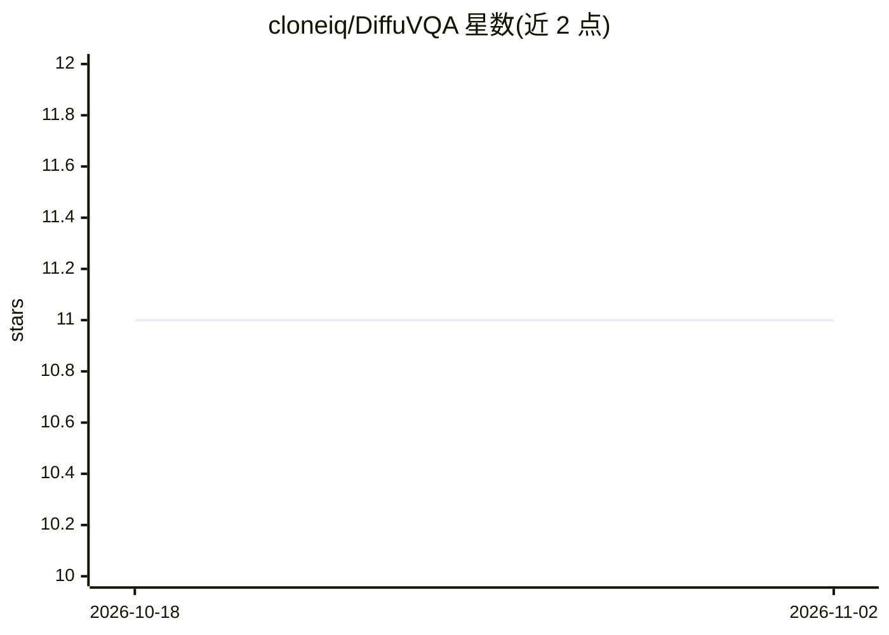

# cloneiq/DiffuVQA

⭐ 11 · Python · 推送 2026-07-15 · [GitHub](https://github.com/cloneiq/DiffuVQA) · [官网](https://github.com/cloneiq/DiffuVQA) · 组织维护

**扩散模型做医学图像问答，生成开放式临床答案**

论文配套代码：将医学视觉问答（Med-VQA）从分类任务重新定义为条件生成任务，用扩散模型根据图像-问题融合特征生成开放式答案。两个关键机制：融合特征嵌入反向扩散过程作条件信号；提出 Conditional Information Gaussian Noising 将融合特征加入前向过程，实现双重条件化而不改变扩散模型的概率结构。在 SLAKE、Kvasir-VQA、Med-VQA 2019 三个公开数据集上评测。基于 PyTorch 与 HuggingFace transformers，提供训练与评估脚本，需自行获取官方数据集。

## 筛选速览

| 维度 | 判定 | 备注 |
|---|---|---|
| AI 角色 | `ai-native` | 本体是模型或模型工具 |
| 许可风险 | `none` | — |
| 部署形态 | `library` | 以包/库形式分发 |
| 模型依赖 | — | README 未给出锁定关系 |
| 硬件要求 | — | 无带数字的原话,不猜 |
| 安装摩擦 | `low` | 无编译、无系统依赖或容器化 |
| 成熟度 | — | 结构信号不足 |

## 能力要点

- 扩散模型生成开放式 Med-VQA 答案（非预定义分类）
- Conditional Information Gaussian Noising 实现前向+反向双重条件化
- 在 SLAKE / Kvasir-VQA / Med-VQA 2019 三个数据集上报告结果
- 提供训练与评估脚本及复现配置

## 适用场景

- 科研人员复现论文中的 Med-VQA 生成式方法
- 在医学图像问答数据集上训练扩散模型
- 对比生成式 Med-VQA 方法的基准结果

## 场景标签

`科研工具` `多模态` · 领域:学习与行业

## 证据(README 行号)

> L3: Medical Visual Question Answering (Med-VQA) aims to provide answers to clinical questions based on medical images, o
> L9: The paper has been published in **Biomedical Signal Processing and Control**, Volume 111, 2026, Article 108222.

## 星数曲线

2026-10-18 11 → 2026-11-02 11（+0）

---
*卡片 v1 · prompt 1.4 · 生成 2026-11-02 · 置信度 mid · 依据 README sha `9ab15438accf` · [字段定义](../../DATASET.md)*
