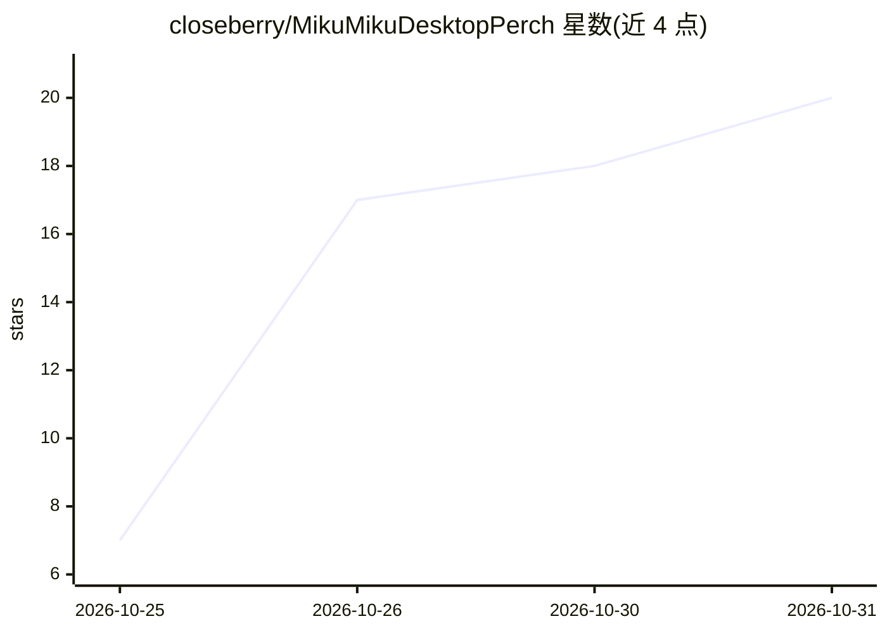

# closeberry/MikuMikuDesktopPerch

⭐ 20 · C++ · MIT · 推送 2026-10-30 · [GitHub](https://github.com/closeberry/MikuMikuDesktopPerch) · 个人维护

**在桌面常驻显示 MMD 模型的吉祥物，支持本地 LLM 对话**

基于 Win32 + Direct3D 12 + DirectComposition 的 Windows 桌面吉祥物：透過显示 PMX 模型，程序生成走路、坐窗缘、悬挂等动作，支持 VMD 待机/点击/走路动作、待机小动作与打瞌睡，最多同时显示 6 个角色。AI 部分：通过 OpenAI 兼容 API 连接本机 LLM（llama.cpp/Ollama/LM Studio，仅限 localhost）对话，带人物设定、长期记忆、亲密度数值、角色间闲聊，以及 VOICEVOX/AivisSpeech 语音与口型同步。需自行准备模型与 VMD 并遵守其许可；从源码构建。

## 筛选速览

| 维度 | 判定 | 备注 |
|---|---|---|
| AI 角色 | `ai-enhanced` | 去掉 AI 部分产品仍成立 |
| 许可风险 | `permissive` | MIT |
| 部署形态 | `desktop` | 安装包/桌面程序 |
| 模型依赖 | local-ok | 支持本地模型 |
| 硬件要求 | — | 无带数字的原话,不猜 |
| 安装摩擦 | `medium` | 含编译或系统依赖之一 |
| 成熟度 | — | 结构信号不足 |

## 能力要点

- 透過显示 PMX 模型，生成走路/坐/悬挂动作，模型未描绘区域可点击穿透
- 连接本机 OpenAI 兼容 API（llama.cpp/Ollama/LM Studio，仅限 localhost）对话，内容不外发
- 人物设定、长期记忆（按模型保存于本地）、亲密度数值与角色间自动闲聊
- VOICEVOX/AivisSpeech 本地语音合成与基于 IME 读音的口型同步
- 最多 6 个角色同屏，各自独立动作、声音、设定与记忆

## 适用场景

- 在桌面养一只会走动、坐下、对小动作和点击有反应的 MMD 角色
- 配合本地 LLM 与语音引擎和桌面角色对话
- 让多个角色在桌面上各自活动并互相聊天

## 场景标签

`AI 助手` `Agent 记忆` `语音合成` · 领域:Agent 开发

## 证据(README 行号)

> L5: デスクトップ上にMMDモデル（PMX）を透過表示する常駐マスコットです。プログラムで生成したオリジナルのモーションで歩いたり、ウィンドウの縁に座ったりぶら下がったり、待機中にしぐさをしたり、クリックに反応したりします。VMDモーショ
> L58: ## 話しかける（ローカルLLM）
> L62: - **準備**：llama.cpp の `llama-server`、Ollama、LM Studio など、OpenAI互換のAPI（`/v1/chat/completions`）を持つLLMのサーバーを用意し、日本語が得意な

## 星数曲线

2026-10-25 7 → 2026-10-31 20（+13）

---
*卡片 v1 · prompt 1.4 · 生成 2026-10-29 · 置信度 high · 依据 README sha `7ad19a100b51` · [字段定义](../../DATASET.md)*
