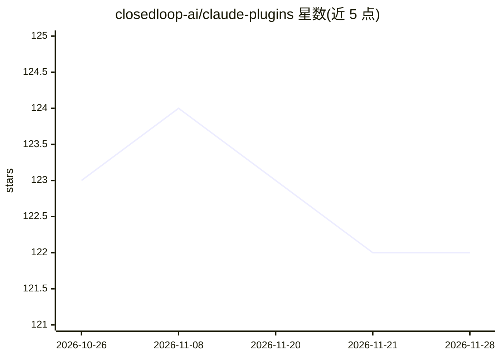

# closedloop-ai/claude-plugins

⭐ 122 · JavaScript · Apache-2.0 · 推送 2026-11-26 · [GitHub](https://github.com/closedloop-ai/claude-plugins) · 组织维护

**给软件开发团队用的 Claude Code 多智能体插件集**

ClosedLoop.AI 以开源 Claude Code 插件形式发布的一组多智能体 SDLC 工具，覆盖项目引导、实现规划、代码生成迭代循环、带 GitHub PR 内联评论的代码评审、质量评测与模式捕获等；由 8 个插件组成（bootstrap/code/vibe/code-review/platform/self-learning 等），以 artifact 阶段门与自学习机制组织工作流，绑定用户自有代码库。需 Python 3.11+、jq 与 Claude Code；亦提供 Codex 平台的清单支持。官方声明为工程预览，建议在可信环境测试。

## 筛选速览

| 维度 | 判定 | 备注 |
|---|---|---|
| AI 角色 | `ai-ecosystem` | LLM/agent 周边工具 |
| 许可风险 | `permissive` | Apache-2.0 |
| 部署形态 | `None` |  |
| 模型依赖 | — | README 未给出锁定关系 |
| 硬件要求 | — | 无带数字的原话,不猜 |
| 安装摩擦 | `low` | 无编译、无系统依赖或容器化 |
| 成熟度 | `idea` | |

## 能力要点

- 8 个插件覆盖规划、编码、评审、自学习与平台指导
- 一键安装脚本安装四个 Symphony 运行时插件并自动更新
- 同一插件可通过 Codex 清单在多 agent 工作区运行
- 提供 evals/code-review 人工评审评测集

## 适用场景

- 团队用规划门与 PR 评审流程组织 AI 辅助开发
- 在 GitHub PR 上自动生成内联代码评审评论
- 捕获团队模式并沉淀组织知识

## 场景标签

`多智能体` `编码 Agent` `代码审查` `代码生成` · 领域:Agent 开发

## 证据(README 行号)

> L9: ClosedLoop is an AI platform that brings the speed of individual AI-driven development to the full software developm
> L15: That's why we took Claude Code and extended it with a lightweight multi-agent orchestration workflow paradigm that 

## 星数曲线

2026-10-26 123 → 2026-11-28 122（-1）

---
*卡片 v1 · prompt 1.4 · 生成 2026-11-28 · 置信度 high · 依据 README sha `255515fe0a5b` · [字段定义](../../DATASET.md)*
