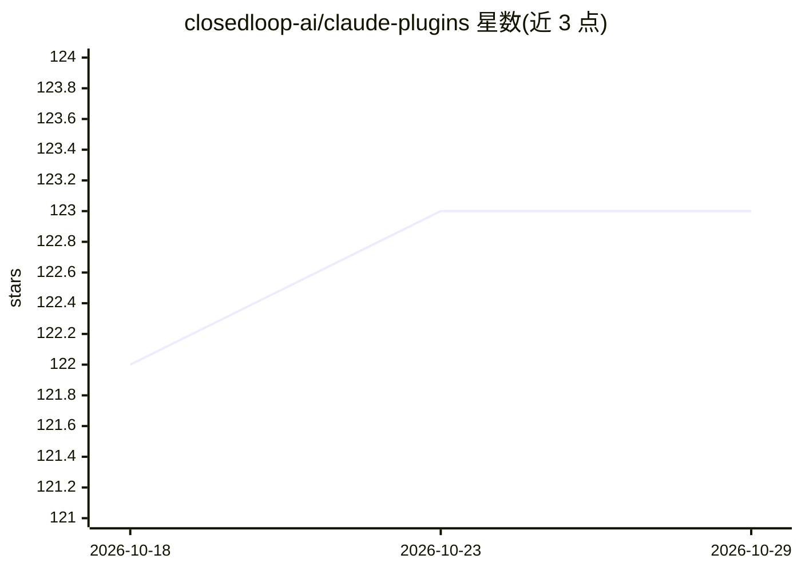

# closedloop-ai/claude-plugins

⭐ 123 · Python · Apache-2.0 · 推送 2026-10-28 · [GitHub](https://github.com/closedloop-ai/claude-plugins) · 组织维护

**面向开发团队的开源 Claude Code 多智能体 SDLC 插件集**

ClosedLoop.AI 公司开源的 Claude Code 插件集合，覆盖项目引导、实现规划与编码循环、自动代码审查（GitHub PR 内联评论）、质量评判与自学习模式沉淀，按 bootstrap/plan/code/ship 阶段组织多智能体工作流，并以你的代码库为上下文。提供 curl 一键安装器、Claude Code marketplace 安装与 Codex manifest 三种接入方式，附带 code-review 人工评审评测集。README 声明这是工程预览版，建议在可信环境中测试使用。

## 筛选速览

| 维度 | 判定 | 备注 |
|---|---|---|
| AI 角色 | `ai-ecosystem` | LLM/agent 周边工具 |
| 许可风险 | `permissive` | Apache-2.0 |
| 部署形态 | `None` |  |
| 模型依赖 | — | README 未给出锁定关系 |
| 硬件要求 | — | 无带数字的原话,不猜 |
| 安装摩擦 | `low` | 无编译、无系统依赖或容器化 |
| 成熟度 | `idea` | |

## 能力要点

- 7 个插件：bootstrap/code/vibe/closedloop-core/code-review/platform/self-learning
- 阶段化工作流门控与多仓库自适应自学习
- 代码审查插件在 GitHub PR 上输出内联评论
- 同一插件行为可在 Claude Code 与 Codex 中运行（含评测集）

## 适用场景

- 在 Claude Code 中用多智能体流程做规划-编码-审查-交付
- 团队将工单转化为实现计划并在 PR 内获得自动审查
- 沉淀团队编码模式并共享组织知识

## 场景标签

`多智能体` `编码 Agent` `代码审查` · 领域:Agent 开发

## 证据(README 行号)

> L9: ClosedLoop is an AI platform that brings the speed of individual AI-driven development to the full software developm
> L15: That's why we took Claude Code and extended it with a lightweight multi-agent orchestration workflow paradigm that 

## 星数曲线

2026-10-18 122 → 2026-10-29 123（+1）

---
*卡片 v1 · prompt 1.4 · 生成 2026-10-23 · 置信度 high · 依据 README sha `10a11b5f8432` · [字段定义](../../DATASET.md)*
