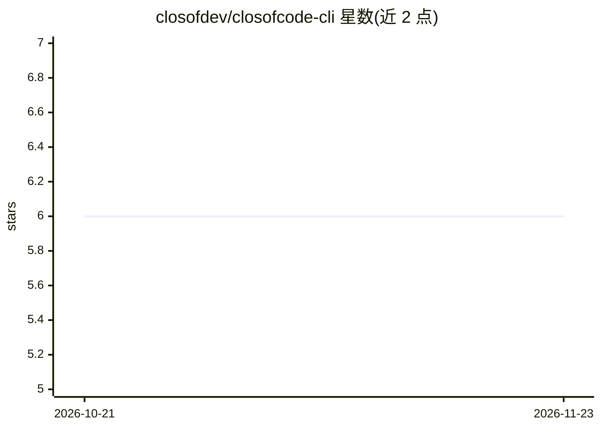

# closofdev/closofcode-cli

⭐ 6 · TypeScript · MIT · 推送 2026-10-08 · [GitHub](https://github.com/closofdev/closofcode-cli) · 个人维护

**面向开发者的终端 TUI AI 代理客户端**

一个终端界面（TUI）项目，是 opencode 的 fork：代理引擎（provider、session、tool、MCP、LSP）全部沿用上游，本仓库主要定制显示层。运行需 Bun，通过 bun install / bun dev 启动，配置沿用 opencode 的全局配置文件格式。采用 MIT 许可并跟随 opencode。面向使用终端与 AI 代理交互的开发者。

## 筛选速览

| 维度 | 判定 | 备注 |
|---|---|---|
| AI 角色 | `ai-ecosystem` | LLM/agent 周边工具 |
| 许可风险 | `permissive` | MIT |
| 部署形态 | `desktop` | 安装包/桌面程序 |
| 模型依赖 | — | README 未给出锁定关系 |
| 硬件要求 | — | 无带数字的原话,不猜 |
| 安装摩擦 | `low` | 无编译、无系统依赖或容器化 |
| 成熟度 | — | 结构信号不足 |

## 能力要点

- 基于 opencode fork，复用上游完整代理引擎（provider/session/tool/MCP/LSP）
- 终端 TUI 界面为主要定制层
- Monorepo 结构含 opencode 运行时、tui、core、sdk、schema 五个包

## 适用场景

- 在终端里与 AI 编码代理对话并运行任务
- 查看可用模型列表（models 命令）
- 在自定义 TUI 层基础上进行二次定制

## 场景标签

`编码 Agent` · 领域:编码与开发

## 证据(README 行号)

> L3: Antarmuka terminal (TUI) untuk opencode.
> L5: Repo ini adalah fork. Semua mesin agen — provider, session, tool, MCP, LSP — berasal dari upstream. Yang disesuaikan

## 星数曲线

2026-10-21 6 → 2026-11-23 6（+0）

---
*卡片 v1 · prompt 1.4 · 生成 2026-11-20 · 置信度 mid · 依据 README sha `a82aab50f2e8` · [字段定义](../../DATASET.md)*
