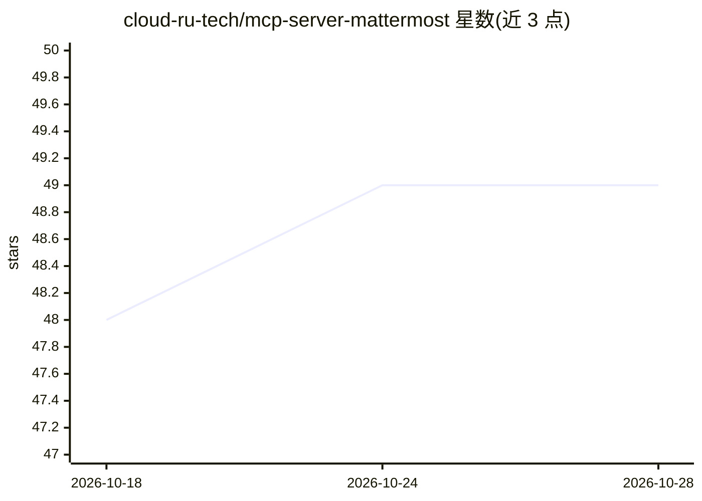

# cloud-ru-tech/mcp-server-mattermost

⭐ 49 · Python · MIT · 推送 2026-10-22 · [GitHub](https://github.com/cloud-ru-tech/mcp-server-mattermost) · [官网](https://mcp-server-mattermost.readthedocs.io) · 组织维护

**让 AI 助手读写 Mattermost 频道/消息/文件的 MCP 服务器**

面向 Claude Desktop、Cursor 等 MCP 客户端的 Mattermost 连接服务器，基于 Python（FastMCP）实现，提供 39 个工具覆盖频道、消息、表情回应、线程、用户、团队、文件与书签（书签需 Mattermost Entry+ 版本 v10.1+）。支持 stdio 与 HTTP 两种传输模式，认证方式含 static_token、client_token 与 Mattermost OAuth 代理。通过 PyPI、Docker（legard/mcp-server-mattermost）或源码安装，需配置 Mattermost URL 与 token。HTTP 模式下 static_token 会启动未鉴权端点并记录警告，Host/Origin 保护默认关闭。

## 筛选速览

| 维度 | 判定 | 备注 |
|---|---|---|
| AI 角色 | `ai-ecosystem` | LLM/agent 周边工具 |
| 许可风险 | `permissive` | MIT |
| 部署形态 | `self-host` | docker 或自建部署 |
| 模型依赖 | — | README 未给出锁定关系 |
| 硬件要求 | — | 无带数字的原话,不猜 |
| 安装摩擦 | `low` | 无编译、无系统依赖或容器化 |
| 成熟度 | — | 结构信号不足 |

## 能力要点

- 39 个工具覆盖频道/消息/回应/线程/用户/团队/文件/书签
- stdio 与 HTTP 双传输模式，支持 Docker 部署
- 三种认证模式：static_token、client_token、Mattermost OAuth 代理
- 书签工具需 Mattermost Entry+ 版本（v10.1+）

## 适用场景

- 让 Claude/Cursor 直接查询和总结 Mattermost 频道动态
- 通过对话让 AI 助手向频道发送消息、上传文件
- 团队协作场景中用 AI 检索历史消息与线程

## 场景标签

 · 领域:AI 工具集成/团队协作

## 证据(README 行号)

> L5: Let AI assistants read, search, and post in your Mattermost workspace
> L9: MCP Server
> L132: > **Full setup guide** — Claude Desktop, Cursor, Claude Code, Opencode, Docker, pip

## 星数曲线

2026-10-18 48 → 2026-10-28 49（+1）

---
*卡片 v1 · prompt 1.4 · 生成 2026-10-24 · 置信度 mid · 依据 README sha `abcc9b04332d` · [字段定义](../../DATASET.md)*
