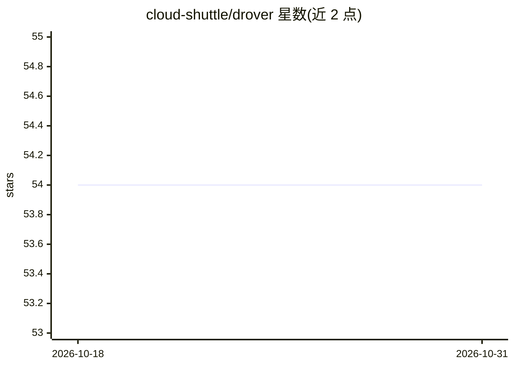

# cloud-shuttle/drover

⭐ 54 · Go · MIT · 推送 2026-05-26 · [GitHub](https://github.com/cloud-shuttle/drover) · 组织维护

**并行运行多个 AI 编码 agent 的持久化工作流编排器**

基于 Go 与 DBOS v0.14.0 的持久化工作流编排器：将项目任务构建依赖图，同时调度 4-16 个 AI 编码 agent（Claude Code/Codex/Amp/OpenCode/Drover Code，可插拔接口）并行执行；每个 worker 在独立 git worktree 中工作，变更按任务提交后合回主分支。每步检查点入库，崩溃后通过 drover resume 从断点恢复；支持层级子任务、自动重试（指数退避）、AIMD 自适应并发与 OpenTelemetry 观测。开发模式用 SQLite 零配置，生产需 PostgreSQL。面向使用 AI 编码 agent 的开发者，通过 CLI 与本地 web 控制台操作。

## 筛选速览

| 维度 | 判定 | 备注 |
|---|---|---|
| AI 角色 | `ai-ecosystem` | LLM/agent 周边工具 |
| 许可风险 | `permissive` | MIT |
| 部署形态 | `self-host` | docker 或自建部署 |
| 模型依赖 | — | README 未给出锁定关系 |
| 硬件要求 | — | 无带数字的原话,不猜 |
| 安装摩擦 | `low` | 无编译、无系统依赖或容器化 |
| 成熟度 | — | 结构信号不足 |

## 能力要点

- 依赖图驱动的 4-16 个 AI agent 并行执行
- DBOS 持久化执行：崩溃/重启后从检查点恢复
- 每 worker 独立 git worktree 隔离，按任务提交合并
- 可插拔 agent 接口：Claude Code/Codex/Amp/OpenCode/Drover Code
- 内置 OpenTelemetry 追踪与指标（默认关闭）

## 适用场景

- 把含大量任务的项目交给多个 AI 编码 agent 并行完成
- 长任务中断后从断点恢复而非重跑
- 对并行 agent 执行做实时进度与依赖图跟踪

## 场景标签

`编码 Agent` `多智能体` · 领域:Agent 开发

## 证据(README 行号)

> L7: Drover is a durable workflow orchestrator that runs multiple AI coding agents in parallel to complete your entire pr
> L92: Drover supports multiple AI coding agents through a pluggable interface:
> L301: |Agent Interface|Pluggable|Support for Claude, Codex, Amp, OpenCode, Drover Code|

## 星数曲线

2026-10-18 54 → 2026-10-31 54（+0）

---
*卡片 v1 · prompt 1.4 · 生成 2026-10-24 · 置信度 mid · 依据 README sha `3dc98ed97e24` · [字段定义](../../DATASET.md)*
