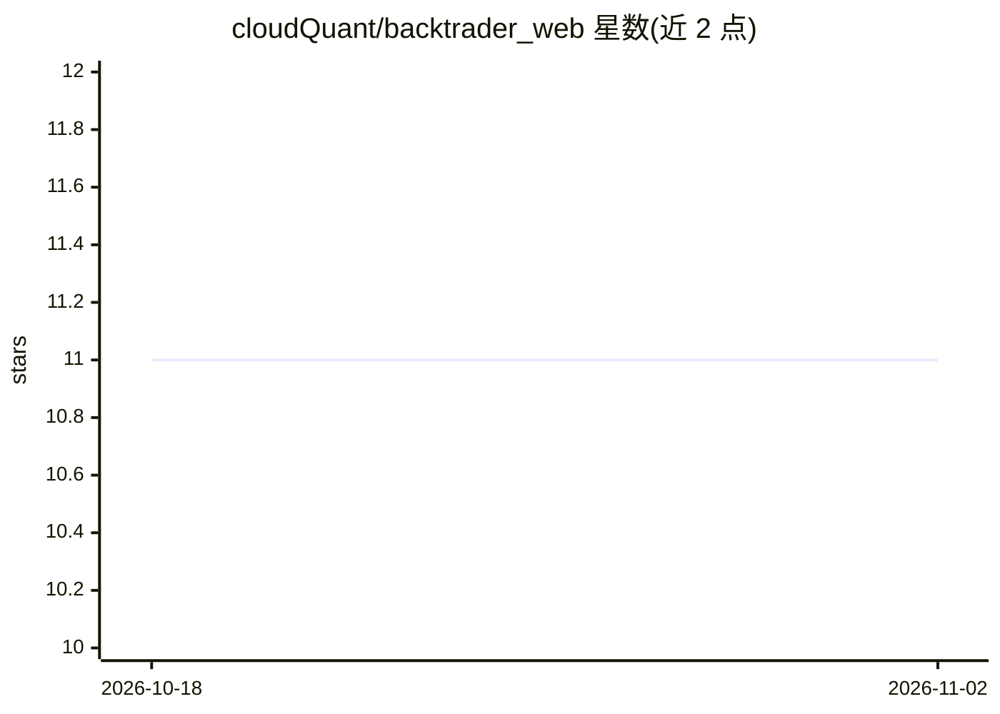

# cloudQuant/backtrader_web

⭐ 11 · Python · MIT · 推送 2026-10-26 · [GitHub](https://github.com/cloudQuant/backtrader_web) · [官网](https://aifortrader.cn/) · 组织维护 · 中文 README

**面向量化交易者的 Backtrader 全周期策略 Web 平台，含 AI 辅助**

基于 Vue 3 + FastAPI 的量化研究平台：将知识库检索（引用型问答、词法/可选语义检索）、Backtrader 策略创建与 AI 草案生成、市场数据预检与受控在线补齐、回测与稳健性验证、模拟/实盘运行及组合风险观察连接为可追溯工作流，供量化交易者与投研团队使用。策略代码在受限环境运行，AI 与回测输出均要求人工复核；AI 模型经 OpenAI-compatible 接口接入且可不可用（保留默认方案）。

## 筛选速览

| 维度 | 判定 | 备注 |
|---|---|---|
| AI 角色 | `ai-enhanced` | 去掉 AI 部分产品仍成立 |
| 许可风险 | `permissive` | MIT |
| 部署形态 | `self-host` | docker 或自建部署 |
| 模型依赖 | — | README 未给出锁定关系 |
| 硬件要求 | — | 无带数字的原话,不猜 |
| 安装摩擦 | `low` | 无编译、无系统依赖或容器化 |
| 成熟度 | — | 结构信号不足 |

## 能力要点

- 引用型知识库问答（词法检索 + 可选语义检索）
- Backtrader 策略生成/版本/回测/稳健性验证与参数优化
- 本地行情仓优先 + v2 受控在线补齐（默认关闭）
- 研究/交易工作区与账户、持仓、P&L、回撤组合视图

## 适用场景

- 量化团队从研究依据到回测验证、模拟与实盘运行的全流程管理
- 在团队知识库中检索带引用来源的研究依据
- 生成并人工复核 Backtrader 策略草案后回测迭代

## 场景标签

`金融量化` `文档问答` `知识库管理` · 领域:知识与检索

## 证据(README 行号)

> L3: AI 驱动的量化研究、策略生成、回测验证与交易辅助平台。
> L14: AI for Investor 面向量化交易者与投研团队，将自然语言研究、知识库检索、策略开发、数据预检、回测验证、交易工作区和组合风险观察连接成可追溯的工作流。它帮助研究人员更快形成和验证假设，但不替代数据校验、风险控制或人工交
> L94: - **AI 策略必须复核。** “生成研究目标”允许选择默认方案或由当前模型优化；模型不可用时保留默认方案。策略代码在受限环境中运行，禁止覆盖 `self.close()` 等交易方法；价格序列应使用 `self.dataclo

## 星数曲线

2026-10-18 11 → 2026-11-02 11（+0）

---
*卡片 v1 · prompt 1.4 · 生成 2026-11-02 · 置信度 mid · 依据 README sha `6cf9c2a67e4e` · [字段定义](../../DATASET.md)*
