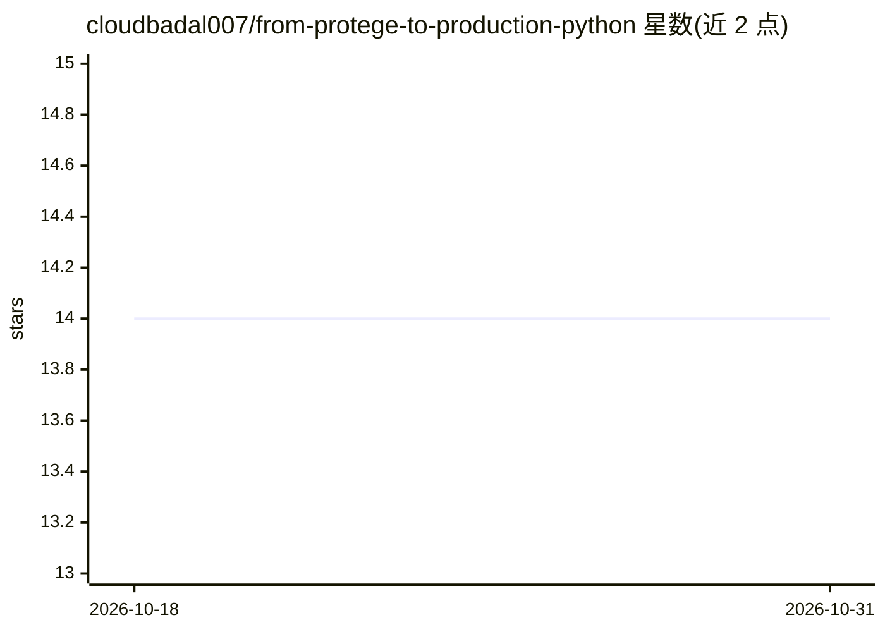

# cloudbadal007/from-protege-to-production-python

⭐ 14 · Python · MIT · 推送 2026-01-10 · [GitHub](https://github.com/cloudbadal007/from-protege-to-production-python) · 个人维护

**OWL 本体推理驱动的餐厅推荐 REST API 教学示例项目**

教程配套代码：演示从 Protégé 创建 OWL 本体到用 Python 部署 REST API 的完整流程。基于 Owlready2 加载 RDF/XML 本体、程序化添加实例，并由 OWL reasoner 自动分类（如推断 VegetarianDish），最终通过 Flask 提供 5 个端点，包括基于本体推理的餐厅推荐（按素食/价格/评分/菜系过滤）。包含 pytest 测试套件与 QUICKSTART 等文档；面向无本体经验的学习者，限制为示例领域（餐厅）与小规模数据。

## 筛选速览

| 维度 | 判定 | 备注 |
|---|---|---|
| AI 角色 | `ai-native` | 本体是模型或模型工具 |
| 许可风险 | `permissive` | MIT |
| 部署形态 | `library` | 以包/库形式分发 |
| 模型依赖 | — | README 未给出锁定关系 |
| 硬件要求 | — | 无带数字的原话,不猜 |
| 安装摩擦 | `low` | 无编译、无系统依赖或容器化 |
| 成熟度 | — | 结构信号不足 |

## 能力要点

- Owlready2 加载与修改 OWL 本体（RDF/XML）
- OWL reasoner 自动分类（推断 VegetarianDish 实例）
- Flask REST API 提供 5 个端点，含基于推理的推荐接口
- 附带 pytest 测试套件与分步快速上手文档

## 适用场景

- 学习如何在 Python 中集成 Protégé 创建的 OWL 本体
- 参考 OWL 推理结果对接 REST API 的实现方式
- 作为知识图谱与 Web 服务集成的入门示例运行与改造

## 场景标签

`教程课程` `知识图谱` · 领域:知识与检索

## 证据(README 行号)

> L28: DineWise is a semantic web application that uses OWL ontology reasoning to provide intelligent restaurant recommend
> L32: - Automatic classification using OWL reasoners

## 星数曲线

2026-10-18 14 → 2026-10-31 14（+0）

---
*卡片 v1 · prompt 1.4 · 生成 2026-10-31 · 置信度 mid · 依据 README sha `877bb3750b07` · [字段定义](../../DATASET.md)*
