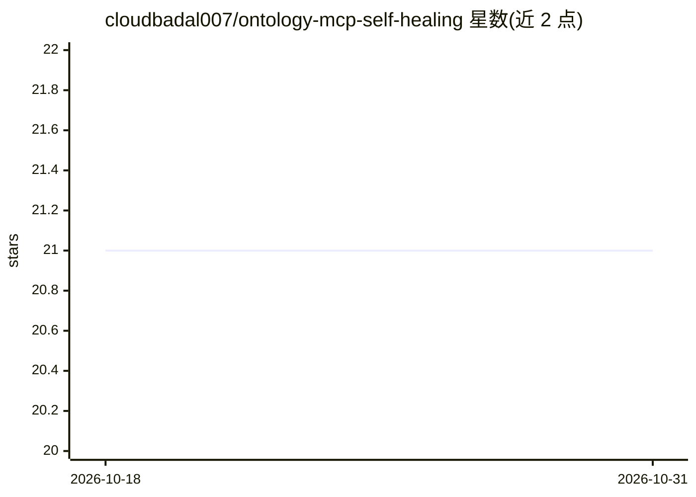

# cloudbadal007/ontology-mcp-self-healing

⭐ 21 · Python · MIT · 推送 2026-01-17 · [GitHub](https://github.com/cloudbadal007/ontology-mcp-self-healing) · 个人维护

**数据库模式变更时自动修复本体映射的自愈多 Agent 系统**

基于 MCP 协议的自愈多 Agent 系统：持续监控数据库模式（SHA-256 哈希检测），检测变更后用 Claude 分析差异并自动更新 OWL 本体映射，随后热重载 MCP 工具，使 Agent 在数据库演进时无需人工修改即可继续工作。MCP 服务器从本体动态生成工具、将语义查询翻译为 SQL。面向部署 AI Agent 且数据库结构频繁变动的开发者，支持 SQLite/PostgreSQL/MySQL，提供 Docker、测试与审计日志，需配置 ANTHROPIC_API_KEY。

## 筛选速览

| 维度 | 判定 | 备注 |
|---|---|---|
| AI 角色 | `ai-ecosystem` | LLM/agent 周边工具 |
| 许可风险 | `permissive` | MIT |
| 部署形态 | `self-host` | docker 或自建部署 |
| 模型依赖 | locked-api |  |
| 硬件要求 | — | 无带数字的原话,不猜 |
| 安装摩擦 | `low` | 无编译、无系统依赖或容器化 |
| 成熟度 | — | 结构信号不足 |

## 能力要点

- SHA-256 哈希监控数据库模式变更并检测重命名/增删列
- 用 Claude 分析 schema diff 并自动更新本体映射（支持人工审批模式）
- MCP 服务器从 OWL 本体动态生成工具并将语义查询翻译为 SQL
- 无停机热重载 MCP 工具，附 Slack/Teams 告警与 JSON 审计日志

## 适用场景

- 数据库表结构频繁变动时保持 Agent 查询可用
- 为多个 Agent 提供共享的语义层与 MCP 工具
- 生产环境部署带自动告警与审计的自愈数据访问层

## 场景标签

`多智能体` · 领域:Agent 开发

## 证据(README 行号)

> L8: A production-ready self-healing multi-agent system that uses ontologies and MCP (Model Context Protocol) to automati
> L36: - ✅ **MCP Protocol Support** - Native Model Context Protocol integration

## 星数曲线

2026-10-18 21 → 2026-10-31 21（+0）

---
*卡片 v1 · prompt 1.4 · 生成 2026-10-28 · 置信度 mid · 依据 README sha `cd2328046315` · [字段定义](../../DATASET.md)*
