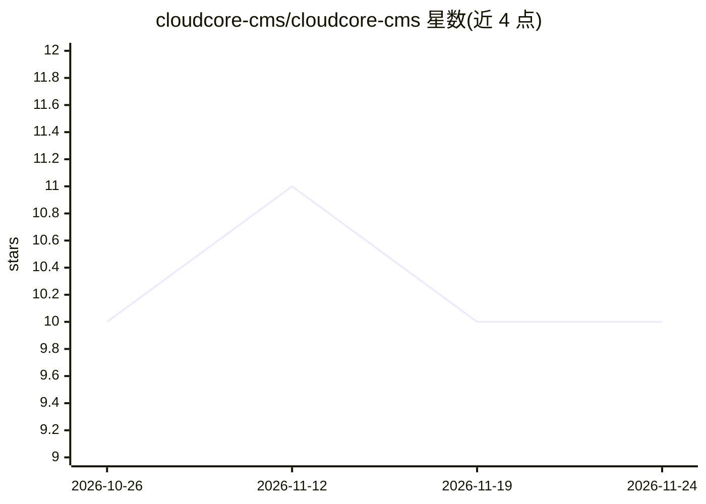

# cloudcore-cms/cloudcore-cms

⭐ 10 · TypeScript · MIT · 推送 2026-05-17 · [GitHub](https://github.com/cloudcore-cms/cloudcore-cms) · [官网](https://cloudcore-cms.github.io/) · 个人维护

**给开发者的 Cloudflare Workers 无头 CMS**

基于 Cloudflare Workers 的开源自托管无头 CMS，MIT 许可，运行于 Cloudflare 免费层（Workers、D1、R2）。提供 13 种类型化内容块（ACF 风格）、React 管理面板、5 种内置认证（含 Passkeys/WebAuthn 与 OAuth）、RBAC、审计日志与只读公共 REST API。仅限 Cloudflare 平台运行，当前为 v0.1.0，README 声明测试覆盖较轻，建议用于个人项目、博客与预发布产品。

## 筛选速览

| 维度 | 判定 | 备注 |
|---|---|---|
| AI 角色 | `ai-enhanced` | 去掉 AI 部分产品仍成立 |
| 许可风险 | `permissive` | MIT |
| 部署形态 | `library` | 以包/库形式分发 |
| 模型依赖 | — | README 未给出锁定关系 |
| 硬件要求 | — | 无带数字的原话,不猜 |
| 安装摩擦 | `low` | 无编译、无系统依赖或容器化 |
| 成熟度 | `idea` | |

## 能力要点

- 块级内容模型：13 种类型化块，含 Tiptap 富文本编辑器
- 5 种内置认证：密码、Passkeys/WebAuthn、魔法链接、GitHub/Google OAuth
- 公共 REST API（/api/v1/public/*）供任意前端调用
- 内容、媒体与审计基于 Cloudflare D1/R2 原语

## 适用场景

- 搭博客或出版物站点，带多作者与修订历史
- 为 Next.js/Astro 等前端提供无头内容 API
- 在 Cloudflare 免费层上自托管营销站点内容
- 内部工具需 RBAC 与审计日志

## 场景标签

 · 领域:Web开发/内容管理

## 证据(README 行号)

> L6: **Cloudcore CMS is a free, open-source, self-hosted headless CMS built on Cloudflare Workers.** Block-based content,
> L14: - **Cloudflare-native** — D1 (SQLite at the edge), R2 (S3-compatible storage), Workers. No AWS account, no Heroku, 
> L124: Not currently. The CMS is built on Cloudflare-specific primitives (D1, R2, Workers). Porting to Node.js + Postgres

## 星数曲线

2026-10-26 10 → 2026-11-24 10（+0）

---
*卡片 v1 · prompt 1.4 · 生成 2026-11-18 · 置信度 mid · 依据 README sha `06550d87b5d2` · [字段定义](../../DATASET.md)*
