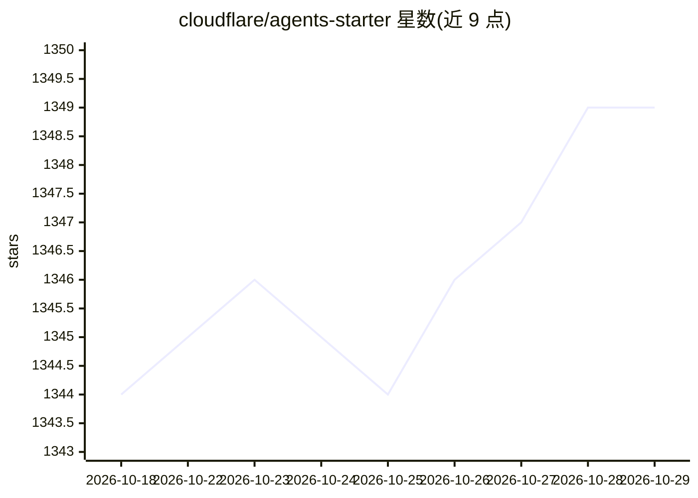

# cloudflare/agents-starter

⭐ 1,349 · TypeScript · MIT · 推送 2026-08-19 · [GitHub](https://github.com/cloudflare/agents-starter) · [官网](https://github.com/cloudflare/agents/) · 组织维护

**在 Cloudflare 上构建 AI 对话 agent 的起步模板**

基于 Cloudflare Agents SDK 的 agent 起步模板：默认使用 Workers AI（无需第三方 API key），内置流式对话、图像输入、三种工具模式（服务端自动执行/客户端/人工审批）、定时任务调度、推理过程展示与 WebSocket 实时同步。内置工具为演示用随机/简单实现，需替换为真实逻辑。需 Cloudflare 登录（wrangler login 或 API token），本地 dev 通过远程代理连接 Workers AI。可切换至 OpenAI/Anthropic，并可接入 MCP 服务器。MIT 许可。

## 筛选速览

| 维度 | 判定 | 备注 |
|---|---|---|
| AI 角色 | `ai-ecosystem` | LLM/agent 周边工具 |
| 许可风险 | `permissive` | MIT |
| 部署形态 | `library` | 以包/库形式分发 |
| 模型依赖 | — | README 未给出锁定关系 |
| 硬件要求 | — | 无带数字的原话,不猜 |
| 安装摩擦 | `low` | 无编译、无系统依赖或容器化 |
| 成熟度 | — | 结构信号不足 |

## 能力要点

- 默认 Workers AI，无需 OpenAI/Anthropic API key，但需 Cloudflare 登录
- 三种工具模式：服务端自动执行、客户端、人工审批
- 定时任务调度（一次性/延迟/cron）与消息 SQLite 持久化
- 支持切换 OpenAI/Anthropic 模型与接入 MCP 服务器

## 适用场景

- 在 Cloudflare Workers 上快速搭建带工具调用的 AI 对话 agent
- 学习 agent 工具模式、调度与实时状态同步的实现
- 以模板为起点定制自己的 agent 并部署到 Cloudflare

## 场景标签

`Agent 框架` · 领域:Agent 开发

## 证据(README 行号)

> L7: A starter template for building AI chat agents on Cloudflare, powered by the Agents SDK.
> L50: - **AI Chat** — Streaming responses powered by Workers AI via `AIChatAgent`

## 星数曲线

2026-10-18 1,344 → 2026-10-29 1,349（+5）

---
*卡片 v1 · prompt 1.4 · 生成 2026-10-21 · 置信度 high · 依据 README sha `071f9cfbb55a` · [字段定义](../../DATASET.md)*
