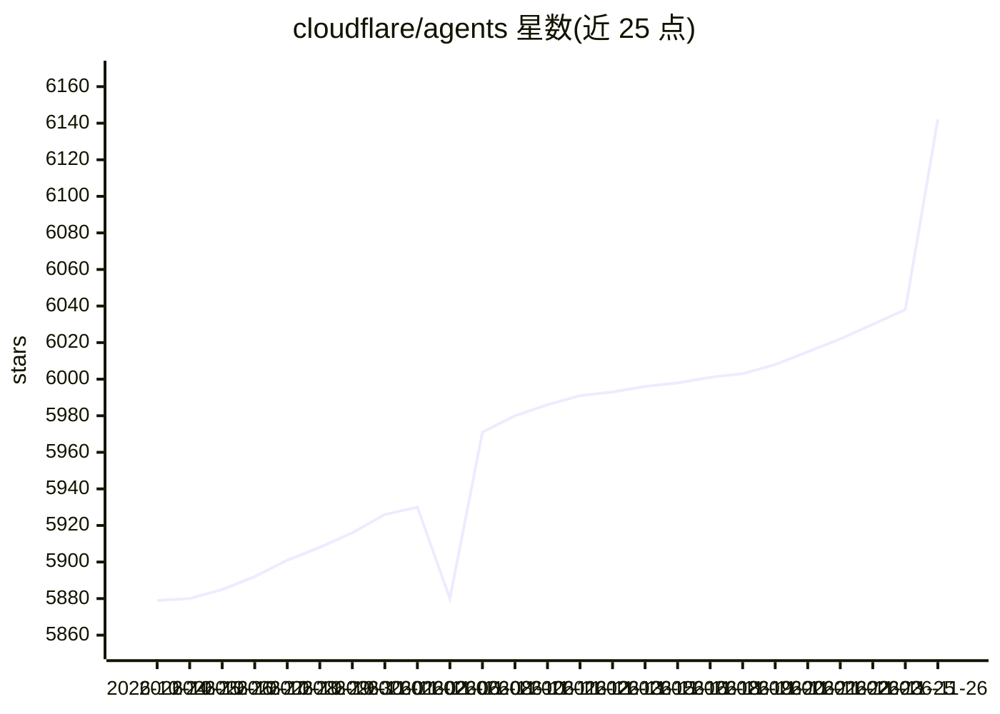

# cloudflare/agents

⭐ 6,142 · TypeScript · MIT · 推送 2026-11-25 · [GitHub](https://github.com/cloudflare/agents) · [官网](https://developers.cloudflare.com/agents/) · 组织维护

**面向开发者在 Cloudflare 上构建和部署有状态 AI Agent 的 SDK**

基于 Cloudflare Durable Objects 的 Agent 构建 SDK：每个 Agent 是持久化、有状态、可休眠唤醒的执行环境，内置状态同步、类型安全 RPC、定时任务、WebSocket、MCP 服务端/客户端、多步工作流（含人工审批）、语音管线（STT/TTS/VAD）、浏览器端 Agent、沙箱执行与 x402 计费等能力。以 npm 包与多个子包（ai-chat、think、codemode、hono 中间件等）形式提供，附 30+ 自包含示例与同步至 developers.cloudflare.com 的文档。目标用户是在 Cloudflare 平台上开发 Agent 应用的开发者。

## 筛选速览

| 维度 | 判定 | 备注 |
|---|---|---|
| AI 角色 | `ai-ecosystem` | LLM/agent 周边工具 |
| 许可风险 | `permissive` | MIT |
| 部署形态 | `library` | 以包/库形式分发 |
| 模型依赖 | — | README 未给出锁定关系 |
| 硬件要求 | — | 无带数字的原话,不猜 |
| 安装摩擦 | `low` | 无编译、无系统依赖或容器化 |
| 成熟度 | — | 结构信号不足 |

## 能力要点

- 基于 Durable Objects 的持久有状态 Agent，空闲休眠、按需唤醒
- 支持 MCP 服务端/客户端、WebMCP 与多步工作流（含 human-in-the-loop）
- 内置语音管线（STT、流式 TTS、VAD）与浏览器端 Agent 运行
- Code Mode：LLM 生成可执行 TypeScript 调用工具，配合沙箱 Worker 运行

## 适用场景

- 在 Cloudflare 上构建每个用户/会话一个实例的有状态聊天助手
- 搭建 MCP 服务端或将远程 MCP 工具桥接到浏览器 agent
- 构建电话/实时语音 Agent（STT、TTS、打断处理）
- 实现带人工审批的多步自动化工作流

## 场景标签

`Agent 框架` · 领域:Agent 开发

## 证据(README 行号)

> L8: Agents are persistent, stateful execution environments for agentic workloads, powered by Cloudflare Durable Objects.
> L64: |**MCP**|Act as MCP servers or connect as MCP clients (HTTP, SSE, RPC, elicitation)|
> L82: |`agents`|Core SDK — Agents, routing, Voice, Channels, scheduling, MCP, workflows, x402, browser agents|

## 星数曲线

2026-10-24 5,879 → 2026-11-26 6,142（+263）

---
*卡片 v1 · prompt 1.4 · 生成 2026-11-26 · 置信度 high · 依据 README sha `1ee598789564` · [字段定义](../../DATASET.md)*
