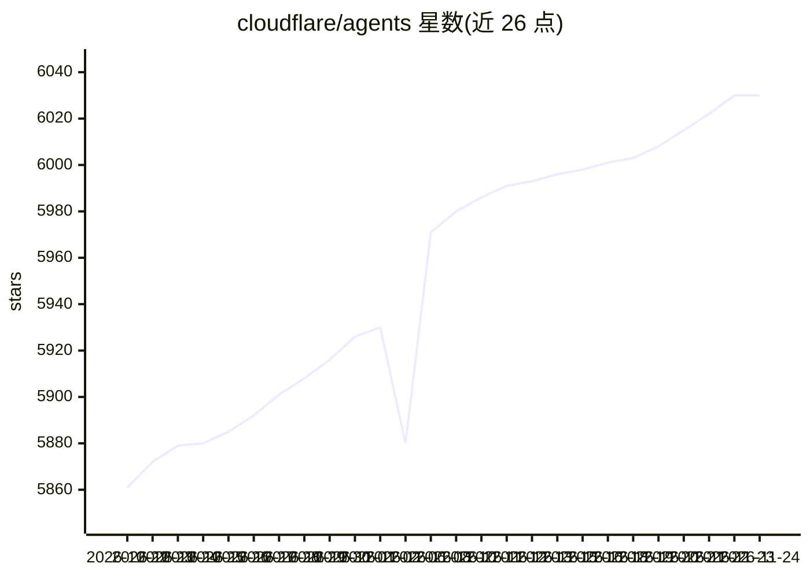

# cloudflare/agents

⭐ 6,038 · TypeScript · MIT · 推送 2026-11-24 · [GitHub](https://github.com/cloudflare/agents) · [官网](https://developers.cloudflare.com/agents/) · 组织维护

**在 Cloudflare 上构建和部署持久化 AI Agent 的 SDK**

基于 Cloudflare Durable Objects 的 Agent 框架：每个 Agent 是拥有独立状态、存储与生命周期的持久执行环境，空闲时休眠、按需唤醒。提供可调用方法的类型安全 RPC、子 Agent 组合、一次性/定时/cron 调度、WebSocket 实时通信、消息持久化与可续传流式聊天、MCP 服务端/客户端、带人工审批的多步工作流、语音流水线（STT/TTS/VAD）、沙箱执行、x402 按次付费及可观测性。含核心 SDK 与 ai-chat/think/codemode 等包、React Hooks，以及 30+ 示例。开发需 Node 24+ 与 pnpm。

## 筛选速览

| 维度 | 判定 | 备注 |
|---|---|---|
| AI 角色 | `ai-ecosystem` | LLM/agent 周边工具 |
| 许可风险 | `permissive` | MIT |
| 部署形态 | `library` | 以包/库形式分发 |
| 模型依赖 | — | README 未给出锁定关系 |
| 硬件要求 | — | 无带数字的原话,不猜 |
| 安装摩擦 | `low` | 无编译、无系统依赖或容器化 |
| 成熟度 | — | 结构信号不足 |

## 能力要点

- 基于 Durable Objects 的持久状态，多客户端自动同步
- MCP 服务端/客户端与 WebMCP 浏览器桥接
- 语音流水线：连续 STT、流式 TTS、VAD、打断处理
- Code Mode：LLM 生成可执行 TypeScript 调用工具

## 适用场景

- 为每个用户/会话/房间部署有状态 Agent
- 构建带持久消息与流式输出的聊天助手
- 实现带人工审批的多步工作流
- 搭建 MCP 服务端或客户端应用

## 场景标签

`Agent 框架` · 领域:Agent 开发

## 证据(README 行号)

> L8: Agents are persistent, stateful execution environments for agentic workloads, powered by Cloudflare Durable Objects.
> L59: |**Sub-agents**|Parent/child DO composition via facets, nested routing, and typed parent lookup|
> L63: |**AI Chat**|Message persistence, resumable streaming, server/client tool execution|

## 星数曲线

2026-10-22 5,861 → 2026-11-24 6,030（+169）

---
*卡片 v1 · prompt 1.4 · 生成 2026-11-22 · 置信度 high · 依据 README sha `5be8f31a6f6d` · [字段定义](../../DATASET.md)*
