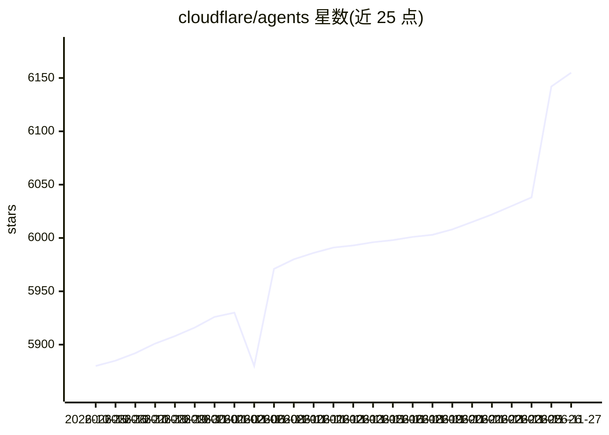

# cloudflare/agents

⭐ 6,155 · TypeScript · MIT · 推送 2026-11-26 · [GitHub](https://github.com/cloudflare/agents) · [官网](https://developers.cloudflare.com/agents/) · 组织维护

**基于 Cloudflare Durable Objects 构建有状态 AI Agent 的 SDK**

Cloudflare 官方的 Agents SDK：以 Durable Objects 为基础提供持久、有状态的 Agent 运行环境，每个 Agent 具备独立状态、存储与生命周期，空闲休眠、按需唤醒。功能覆盖持久状态同步、类型安全 RPC、子 Agent 组合、定时任务、WebSocket、AI 聊天（消息持久化与流式续传）、MCP 服务端/客户端、WebMCP、多步工作流（含人工审批）、语音 STT/TTS、浏览器内 Agent、Code Mode 与沙箱执行等。提供 React Hooks 与 Vanilla JS 客户端，含 30+ 示例。需 Node 24+，依赖 Cloudflare 平台（wrangler 绑定与 SQLite 迁移）。

## 筛选速览

| 维度 | 判定 | 备注 |
|---|---|---|
| AI 角色 | `ai-ecosystem` | LLM/agent 周边工具 |
| 许可风险 | `permissive` | MIT |
| 部署形态 | `library` | 以包/库形式分发 |
| 模型依赖 | — | README 未给出锁定关系 |
| 硬件要求 | — | 无带数字的原话,不猜 |
| 安装摩擦 | `low` | 无编译、无系统依赖或容器化 |
| 成熟度 | — | 结构信号不足 |

## 能力要点

- 基于 Durable Objects 的持久状态与自动多客户端同步
- 内置 MCP 服务端/客户端、WebMCP 与多步工作流（人工审批）
- 语音管线（连续 STT、流式 TTS、VAD）与浏览器内 Agent
- Code Mode：LLM 生成可执行 TypeScript 调用工具

## 适用场景

- 为每个用户/会话部署独立有状态 Agent 实例
- 构建带消息持久化与流式续传的 AI 聊天应用
- 实现需要人工审批的多步工作流
- 将应用同时作为 MCP 服务端与 MCP 客户端接入工具生态

## 场景标签

`Agent 框架` · 领域:Agent 开发

## 证据(README 行号)

> L8: Agents are persistent, stateful execution environments for agentic workloads, powered by Cloudflare Durable Objects.
> L64: |**MCP**|Act as MCP servers or connect as MCP clients (HTTP, SSE, RPC, elicitation)|
> L82: |`agents`|Core SDK — Agents, routing, Voice, Channels, scheduling, MCP, workflows, x402, browser agents|

## 星数曲线

2026-10-25 5,880 → 2026-11-27 6,155（+275）

---
*卡片 v1 · prompt 1.4 · 生成 2026-11-27 · 置信度 high · 依据 README sha `a268b12e3736` · [字段定义](../../DATASET.md)*
