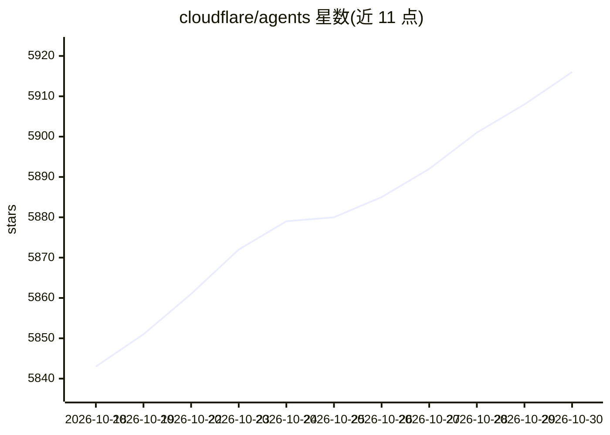

# cloudflare/agents

⭐ 5,916 · TypeScript · MIT · 推送 2026-10-29 · [GitHub](https://github.com/cloudflare/agents) · [官网](https://developers.cloudflare.com/agents/) · 组织维护

**在 Cloudflare 上构建有状态 AI Agent 的 TypeScript SDK**

基于 Cloudflare Durable Objects 的 Agent 开发框架：每个 Agent 拥有独立状态、存储与生命周期，空闲时休眠、按需唤醒。提供类型安全 RPC、子 Agent 组合、调度、WebSocket 实时通信、AI 聊天（持久消息与可恢复流式输出）、MCP 客户端/服务端、Workflows、语音流水线（STT/TTS/VAD）、沙箱代码执行、x402 支付等能力，并附带 React Hooks 与 30+ 示例。面向在 Cloudflare Workers 上部署 Agent 应用及聊天助手的开发者。仓库另含多个包（@cloudflare/ai-chat、@cloudflare/think 等），部分旧包已标记弃用。

## 筛选速览

| 维度 | 判定 | 备注 |
|---|---|---|
| AI 角色 | `ai-ecosystem` | LLM/agent 周边工具 |
| 许可风险 | `permissive` | MIT |
| 部署形态 | `library` | 以包/库形式分发 |
| 模型依赖 | — | README 未给出锁定关系 |
| 硬件要求 | — | 无带数字的原话,不猜 |
| 安装摩擦 | `low` | 无编译、无系统依赖或容器化 |
| 成熟度 | `idea` | |

## 能力要点

- 基于 Durable Objects 的持久有状态 Agent，空闲休眠、按需唤醒
- 类型安全 RPC（@callable 装饰器）与状态自动同步到所有连接客户端
- MCP 客户端/服务端、Workflows 人审流、语音流水线、沙箱代码执行
- Code Mode：LLM 生成可执行 TypeScript 替代逐个工具调用

## 适用场景

- 为每个用户/会话/游戏房间运行独立的有状态 Agent
- 构建带实时同步前端的聊天助手或语音 Agent
- 通过 MCP 协议把 Agent 暴露为工具或接入外部工具
- 实现带人工审批的多步持久化工作流

## 场景标签

`Agent 框架` · 领域:Agent 开发

## 证据(README 行号)

> L8: Agents are persistent, stateful execution environments for agentic workloads, powered by Cloudflare Durable Objects.
> L82: |`agents`|Core SDK — Agents, routing, Voice, Channels, scheduling, MCP, workflows, x402, browser agents|

## 星数曲线

2026-10-18 5,843 → 2026-10-30 5,916（+73）

---
*卡片 v1 · prompt 1.4 · 生成 2026-10-20 · 置信度 high · 依据 README sha `bc95a72cbdea` · [字段定义](../../DATASET.md)*
