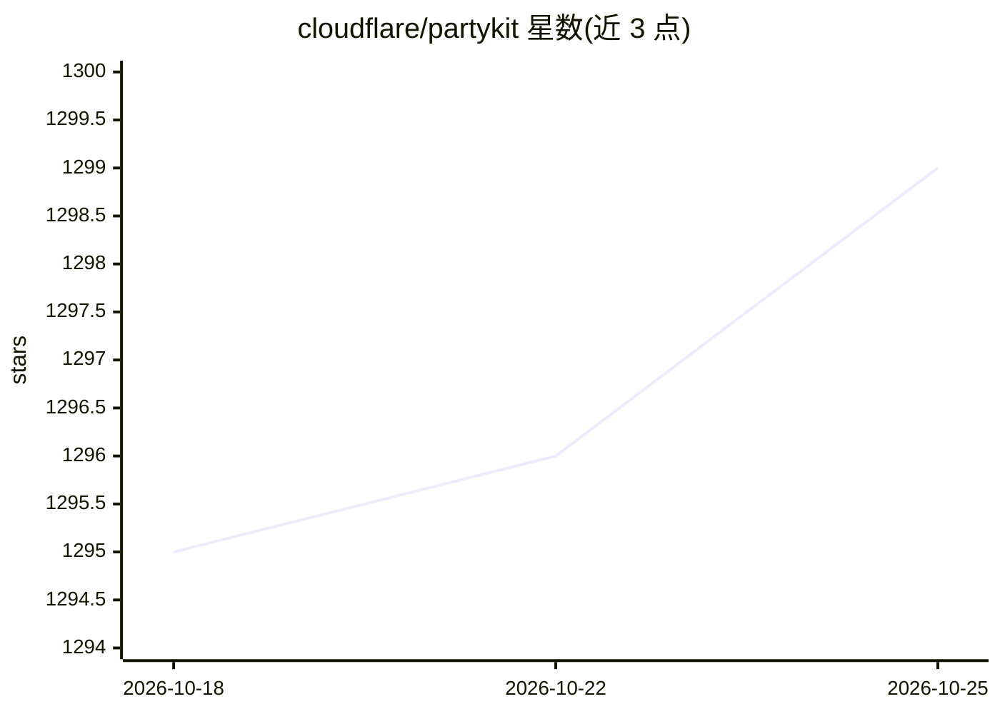

# cloudflare/partykit

⭐ 1,299 · TypeScript · ISC · 推送 2026-08-03 · [GitHub](https://github.com/cloudflare/partykit) · 组织维护

**基于 Cloudflare Durable Objects 的实时应用构建库集合**

Cloudflare 维护的 PartyServer 主仓库，提供一组包：核心库 PartyServer 将标准 Durable Object 增强为易用 WebSocket 服务器（生命周期钩子、广播）；PartySocket 提供带重连与缓冲的 WebSocket 客户端库；Y-PartyServer 为其添加 Yjs CRDT 协同编辑支持；另有大规模 pubsub、状态同步、任务调度等实验性库及 Hono 中间件。面向在 Cloudflare Workers 上构建实时与协作应用（含 agent 场景）的开发者。仓库自述为 Work in Progress。

## 筛选速览

| 维度 | 判定 | 备注 |
|---|---|---|
| AI 角色 | `ai-ecosystem` | LLM/agent 周边工具 |
| 许可风险 | `permissive` | ISC |
| 部署形态 | `None` |  |
| 模型依赖 | — | README 未给出锁定关系 |
| 硬件要求 | — | 无带数字的原话,不猜 |
| 安装摩擦 | `low` | 无编译、无系统依赖或容器化 |
| 成熟度 | `idea` | |

## 能力要点

- PartyServer 将 Durable Object 增强为 WebSocket 服务器，含生命周期钩子与广播
- PartySocket 提供重连、缓冲等特性的 WebSocket 客户端库
- Y-PartyServer 集成 Yjs CRDT 实现实时协同编辑
- 附 fixtures 目录中的独立小型示例

## 适用场景

- 在 Cloudflare Workers 上构建实时多人应用或协作服务
- 为应用添加基于 Yjs 的实时协同编辑
- 需要跨多个 Durable Object 分摊负载的大规模 pubsub 场景

## 场景标签

 · 领域:实时 Web 基础设施

## 证据(README 行号)

> L5: Libraries / Examples / Documentation for building real-time apps (and more!) with Cloudflare Workers. Powered by Dur
> L9: PartyServer - The core library for building real-time applications with Durable Objects. This library enhances a sta

## 星数曲线

2026-10-18 1,295 → 2026-10-25 1,299（+4）

---
*卡片 v1 · prompt 1.4 · 生成 2026-10-21 · 置信度 mid · 依据 README sha `8a937c61fef9` · [字段定义](../../DATASET.md)*
