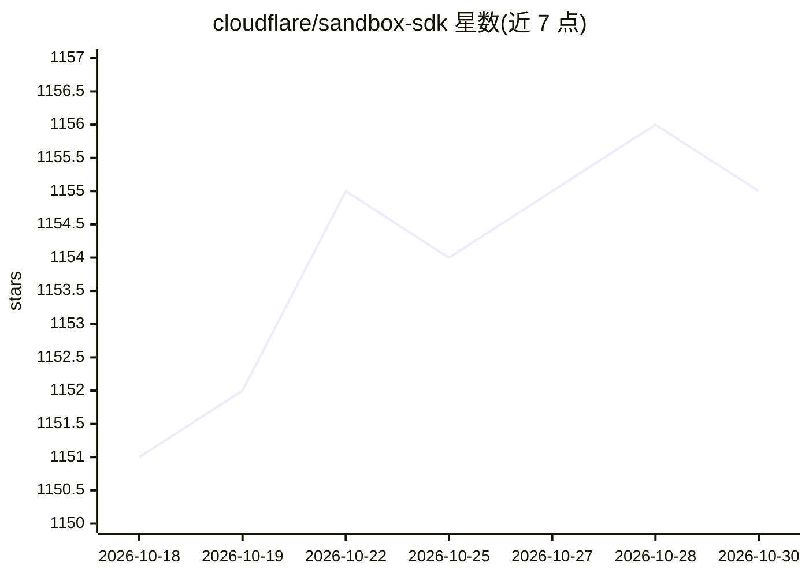

# cloudflare/sandbox-sdk

⭐ 1,155 · TypeScript · NOASSERTION · 推送 2026-10-29 · [GitHub](https://github.com/cloudflare/sandbox-sdk) · [官网](https://sandbox.cloudflare.com/) · 组织维护

**在 Cloudflare 边缘网络运行 Linux 沙箱容器执行不可信代码**

Cloudflare 官方的沙箱 SDK：基于 Durable Object 与 Container，让 Worker 为每个用户、任务或会话启动隔离的 Linux 沙箱，并控制其可访问的主机与凭据。1.0 版本由用户自己的 Durable Object 启动容器，npm 包提供 Files（流式文件进出）、S3Mount（挂载 S3 兼容桶且凭据不入沙箱）、DirectoryBackup（目录存 R2 并可恢复到新镜像容器）三项能力。附带十余个可部署示例（终端、预览、网络管控、coding agents 等）。需构建镜像 shim、Worker 需 nodejs_compat。

## 筛选速览

| 维度 | 判定 | 备注 |
|---|---|---|
| AI 角色 | `ai-ecosystem` | LLM/agent 周边工具 |
| 许可风险 | `none` | NOASSERTION |
| 部署形态 | `library` | 以包/库形式分发 |
| 模型依赖 | — | README 未给出锁定关系 |
| 硬件要求 | — | 无带数字的原话,不猜 |
| 安装摩擦 | `low` | 无编译、无系统依赖或容器化 |
| 成熟度 | — | 结构信号不足 |

## 能力要点

- 以 Durable Object + Container 形式运行每用户/会话独立的 Linux 沙箱
- Files/S3Mount/DirectoryBackup：文件流传输、S3 挂载（凭据不入沙箱）、目录备份恢复
- Worker 层控制沙箱可访问的主机与凭据
- 提供 coding agents、终端、Web 预览等十余个可部署示例

## 适用场景

- 为 AI coding agent 提供隔离的代码执行环境
- 在浏览器中打开沙箱终端或预览运行中的应用
- 按会话隔离地运行不可信或生成的代码

## 场景标签

 · 领域:云基础设施/开发者工具

## 证据(README 行号)

> L8: Run untrusted or generated code in a Linux sandbox that belongs to one user, task, or session. Your Worker decides w
> L51: |Run a coding agent on a repository|Coding agents|`coding-agents`, `templates/devin`, `templates/openai-agents-api`

## 星数曲线

2026-10-18 1,151 → 2026-10-30 1,155（+4）

---
*卡片 v1 · prompt 1.4 · 生成 2026-10-21 · 置信度 high · 依据 README sha `e7cd60d9bba7` · [字段定义](../../DATASET.md)*
