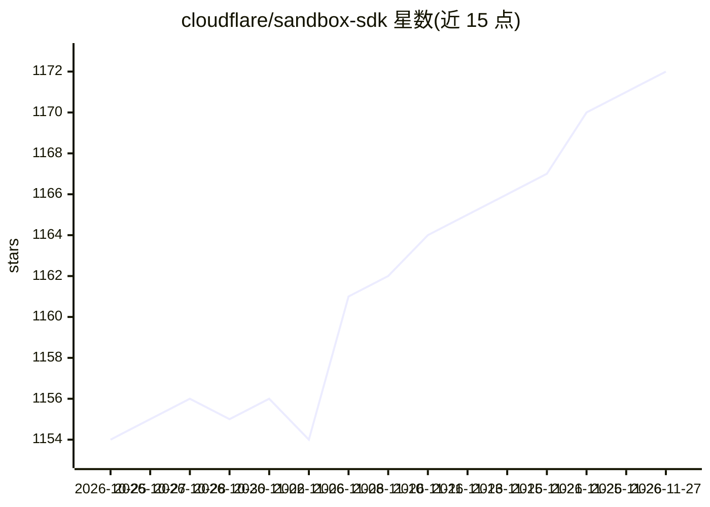

# cloudflare/sandbox-sdk

⭐ 1,172 · TypeScript · NOASSERTION · 推送 2026-11-10 · [GitHub](https://github.com/cloudflare/sandbox-sdk) · [官网](https://sandbox.cloudflare.com/) · 组织维护

**在 Cloudflare 边缘运行沙箱代码环境的 SDK**

Cloudflare 官方 SDK，在边缘网络上为单个用户、任务或会话提供 Linux 沙箱，用于运行不可信或生成的代码。沙箱由 Durable Object 启动并管理容器，提供文件流式读写、S3 兼容桶挂载、目录备份到 R2 并跨容器恢复等能力，凭证经 Worker 签名不进入沙箱。支持后台进程、浏览器终端、端口预览、网络访问控制，含多个可部署示例。需 nodejs_compat，0.x 需迁移。

## 筛选速览

| 维度 | 判定 | 备注 |
|---|---|---|
| AI 角色 | `ai-ecosystem` | LLM/agent 周边工具 |
| 许可风险 | `none` | NOASSERTION |
| 部署形态 | `library` | 以包/库形式分发 |
| 模型依赖 | — | README 未给出锁定关系 |
| 硬件要求 | — | 无带数字的原话,不猜 |
| 安装摩擦 | `low` | 无编译、无系统依赖或容器化 |
| 成熟度 | — | 结构信号不足 |

## 能力要点

- 每个沙箱对应一个用户/任务/会话的隔离 Linux 环境
- Files 文件流、S3Mount 桶挂载、DirectoryBackup 备份恢复三组扩展
- 凭证由 Worker 签名，不进入沙箱
- 提供 coding agents、终端、预览等多个可部署示例模板

## 适用场景

- 为 AI 生成的代码提供隔离执行环境
- 在沙箱中运行编码 agent 操作代码仓库
- 在浏览器中打开远程 shell 调试
- 挂载 R2/S3 桶处理文件并保存工作区快照

## 场景标签

`编码 Agent` · 领域:编码与开发

## 证据(README 行号)

> L8: Run untrusted or generated code in a Linux sandbox that belongs to one user, task, or session. Your Worker decides w
> L51: |Run a coding agent on a repository|Coding agents|`coding-agents`, `templates/devin`, `templates/openai-agents-api`

## 星数曲线

2026-10-25 1,154 → 2026-11-27 1,172（+18）

---
*卡片 v1 · prompt 1.4 · 生成 2026-11-23 · 置信度 high · 依据 README sha `9e76b3258670` · [字段定义](../../DATASET.md)*
