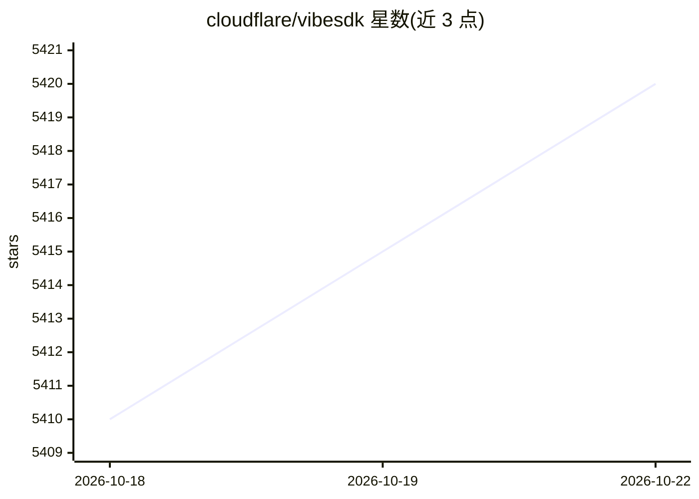

# cloudflare/vibesdk

⭐ 5,420 · TypeScript · MIT · 推送 2026-09-22 · [GitHub](https://github.com/cloudflare/vibesdk) · [官网](https://build.cloudflare.dev) · 组织维护

**开源 vibe coding 平台：用 AI 编码代理在 Cloudflare 上构建全栈应用**

Cloudflare 维护的开源 agentic 平台，用户以自然语言描述需求，由 ThinkAgent 驱动的模型-工具循环完成编码：在 SpaceDO 工作区读写文件、经 Worker Loader 部署 Dynamic Worker 预览、检查浏览器控制台错误并迭代修复，支持人机澄清问答、SQLite 应用数据存储、Artifacts 版本历史与回滚、项目导出。模型供应商经 AI Gateway 路由，需自带 provider 凭证。自部署需 Cloudflare 账号、Workers 付费计划、Node.js 18+ 与 Bun，通过 git clone + bun 脚本本地运行或 Deploy to Cloudflare 一键部署。

## 筛选速览

| 维度 | 判定 | 备注 |
|---|---|---|
| AI 角色 | `ai-native` | 本体是模型或模型工具 |
| 许可风险 | `permissive` | MIT |
| 部署形态 | `None` |  |
| 模型依赖 | — | README 未给出锁定关系 |
| 硬件要求 | — | 无带数字的原话,不猜 |
| 安装摩擦 | `low` | 无编译、无系统依赖或容器化 |
| 成熟度 | — | 结构信号不足 |

## 能力要点

- 模型-工具循环的 agentic 代码生成，支持人机澄清问答
- Dynamic Worker 预览部署与浏览器控制台错误检查/修复闭环
- Durable Object 隔离工作区与 per-app SQLite 存储
- Cloudflare Artifacts 版本历史与可回滚还原点

## 适用场景

- 通过对话让 AI 代理生成并部署全栈应用到 Cloudflare
- 查看实时文件编辑、预览状态并回滚到历史版本
- 导出生成的项目继续在平台外开发

## 场景标签

`编码 Agent` · 领域:编码与开发

## 证据(README 行号)

> L11: VibeSDK lets people build full-stack applications by working with an AI coding agent. Describe what you want, answe
> L17: - **Agentic code generation**: Build iteratively through a model-and-tool loop instead of a fixed sequence of gener

## 星数曲线

2026-10-18 5,410 → 2026-10-22 5,420（+10）

---
*卡片 v1 · prompt 1.4 · 生成 2026-10-20 · 置信度 high · 依据 README sha `c80fe105bce1` · [字段定义](../../DATASET.md)*
