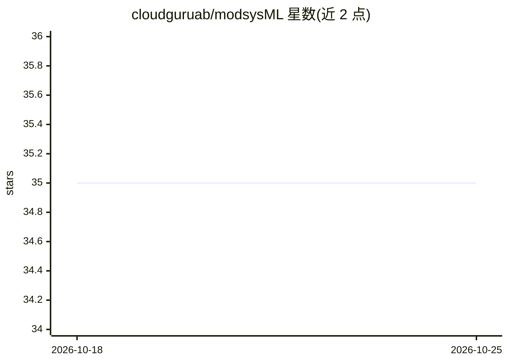

# cloudguruab/modsysML

⭐ 35 · Python · Apache-2.0 · 推送 2026-08-01 · [GitHub](https://github.com/cloudguruab/modsysML) · 组织维护

**LLM 输出评测与提示调优的 Python SDK/CLI 框架**

ModsysML（modsys）是开源的模型响应评测工具箱：以 Python SDK 与 CLI 形式，对多个 prompt 在预定义测试用例上批量运行、并排比较 LLM 输出，支持语义、LLM 评测、Human-in-the-loop 与程序化四类测试。通过统一 API 接入 OpenAI 等提供商及任意数据库/API 资源，输出 JSON/CSV/YAML 表格用于回归检测与决策流；可设置 expectations 自动标记劣质输出。模型质量测试为 beta 功能，UI 尚未发布。

## 筛选速览

| 维度 | 判定 | 备注 |
|---|---|---|
| AI 角色 | `ai-ecosystem` | LLM/agent 周边工具 |
| 许可风险 | `permissive` | Apache-2.0 |
| 部署形态 | `library` | 以包/库形式分发 |
| 模型依赖 | — | README 未给出锁定关系 |
| 硬件要求 | — | 无带数字的原话,不猜 |
| 安装摩擦 | `low` | 无编译、无系统依赖或容器化 |
| 成熟度 | `idea` | |

## 能力要点

- 多 prompt 并排评测与回归检测，输出 json/csv/yaml/html
- 语义、LLM 评测、Human-in-the-loop、程序化四类测试域
- 统一 API 接入 AI 提供商、API 与数据库资源
- 支持自定义规则（Modsys.rule）与缓存/并发加速评测

## 适用场景

- 系统化调优 LLM 提示词并捕捉质量回归
- 对多个模型/提供商输出做并排比较评估
- 为内容审核、风控等场景搭建自动化评测流水线

## 场景标签

`模型评测` `提示工程` · 领域:Agent 开发

## 证据(README 行号)

> L15: ModsysML provides a framework for building relevant test cases across 4 domains, semantic, LLM based, Human in the 
> L29: `modsys` helps you tune LLM prompts systematically across many relevant test cases. By evaluating and comparing LLM
> L43: - Use as a **command line tool, or integrate into your workflow with our library**

## 星数曲线

2026-10-18 35 → 2026-10-25 35（+0）

---
*卡片 v1 · prompt 1.4 · 生成 2026-10-25 · 置信度 high · 依据 README sha `2e316e536076` · [字段定义](../../DATASET.md)*
