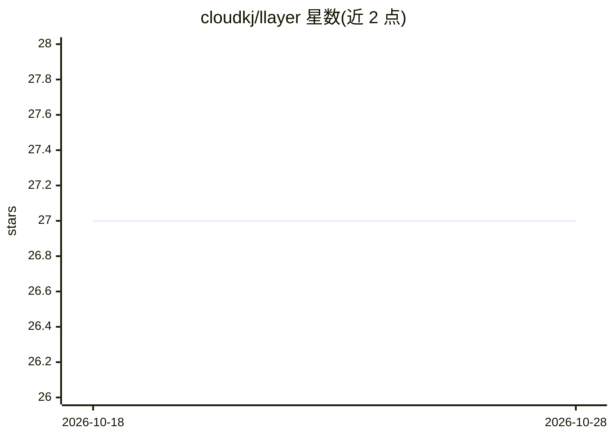

# cloudkj/llayer

⭐ 27 · Shell · MIT · 推送 2026-06-24 · [GitHub](https://github.com/cloudkj/llayer) · 个人维护

**用 bash/curl/jq 以 Unix 管道方式构建 AI agent 的工具集**

由若干单一用途命令（ll-read/ll-context/ll-eval/ll-dispatch/ll-print）组成的无框架 agent 工具集，各命令通过标准文本管道组合成 REPL 式 agent 循环。状态存储于 append-only 的 .jsonl 历史文件，逐 token 事件保留以支持审计、回放与时间旅行调试（如 head -n 20 切片回退记忆）。上下文由 jq 流 reducer 从历史构建，工具以纯 Bash 函数添加。面向熟悉 Unix 工具链的开发者；README 自述为实验性项目。

## 筛选速览

| 维度 | 判定 | 备注 |
|---|---|---|
| AI 角色 | `ai-ecosystem` | LLM/agent 周边工具 |
| 许可风险 | `permissive` | MIT |
| 部署形态 | `self-host` | docker 或自建部署 |
| 模型依赖 | local-ok | 支持本地模型 |
| 硬件要求 | — | 无带数字的原话,不猜 |
| 安装摩擦 | `low` | 无编译、无系统依赖或容器化 |
| 成熟度 | `idea` | |

## 能力要点

- agent 生命周期拆解为可独立调用的单一命令，经 POSIX 管道组合
- append-only .jsonl 历史：事件级审计、重放与时间旅行调试
- 纯 Bash 函数即工具，stdout 直接成为 agent 输入
- 可用 grep/pv 等标准工具拦截与度量模型流

## 适用场景

- 想以 Unix 管道方式理解/构建 agent 循环的开发者实验
- 对 agent 状态与上下文构建过程做逐事件审计与回放
- 以最小依赖（bash/curl/jq）搭建可组合的 LLM 调用管线

## 场景标签

`Agent 框架` `Agent 记忆` · 领域:Agent 开发

## 证据(README 行号)

> L3: **Framework-free AI agents built with `bash`, `curl`, and `jq`**
> L5: `llayer` is an experiment in applying the Unix philosophy to large language model orchestration. Everything is handl
> L6: through a suite of small, single-purpose commands interfacing over standard text pipes to produce a REPL-style agent

## 星数曲线

2026-10-18 27 → 2026-10-28 27（+0）

---
*卡片 v1 · prompt 1.4 · 生成 2026-10-26 · 置信度 high · 依据 README sha `a77a95f9c9fe` · [字段定义](../../DATASET.md)*
