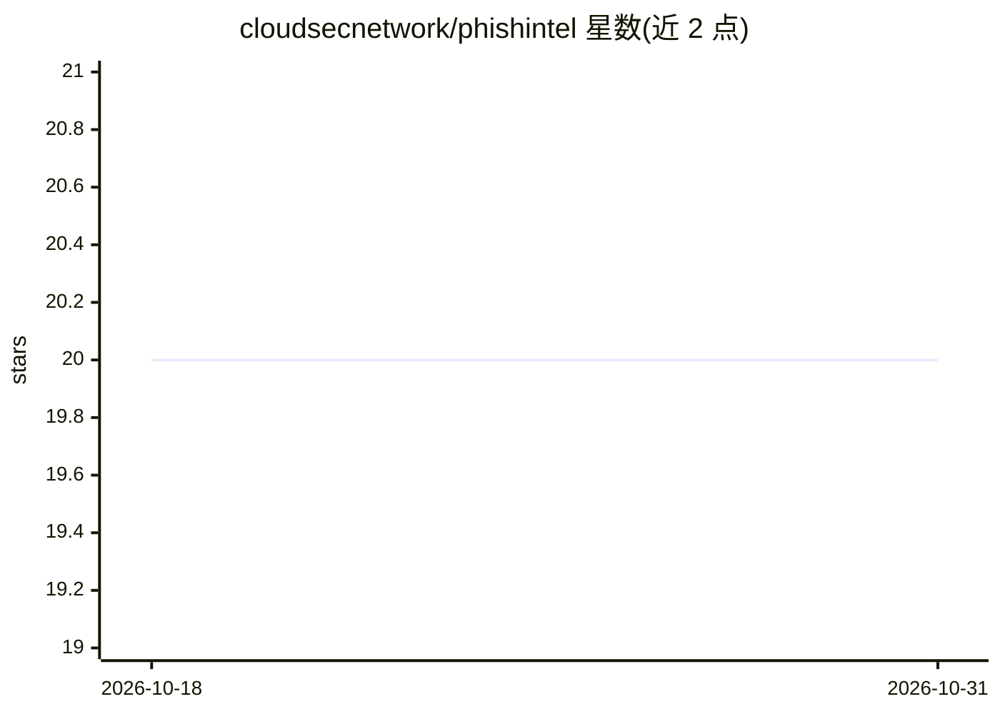

# cloudsecnetwork/phishintel

⭐ 20 · JavaScript · GPL-3.0 · 推送 2026-03-15 · [GitHub](https://github.com/cloudsecnetwork/phishintel) · [官网](https://phishintel.com/) · 组织维护

**面向企业的 AI 钓鱼模拟工具：安全意识培训**

开源的钓鱼模拟工具，用 AI 生成仿照真实攻击手法的钓鱼邮件内容，支持按组织需求定制钓鱼内容、排期与活动参数；记录用户对模拟攻击的响应，输出点击率、提交模式与活动有效性等报告，用于识别高风险人员并评估培训效果。前后端分离（Node.js 后端 + React 前端），数据存于 MongoDB，提供 Docker 与 docker-compose 部署方式及环境变量配置说明。

## 筛选速览

| 维度 | 判定 | 备注 |
|---|---|---|
| AI 角色 | `ai-native` | 本体是模型或模型工具 |
| 许可风险 | `viral` | GPL-3.0 |
| 部署形态 | `self-host` | docker 或自建部署 |
| 模型依赖 | — | README 未给出锁定关系 |
| 硬件要求 | — | 无带数字的原话,不猜 |
| 安装摩擦 | `low` | 无编译、无系统依赖或容器化 |
| 成熟度 | — | 结构信号不足 |

## 能力要点

- AI 驱动生成贴合组织语境的钓鱼活动内容
- 用户响应追踪与点击率/提交模式分析报告
- 钓鱼内容、排期与活动参数可配置
- docker-compose 一键启动应用与 MongoDB，数据持久化

## 适用场景

- 在组织内部开展钓鱼演练评估员工安全意识
- 识别高风险人员或群体并针对性培训
- 衡量安全培训项目的效果变化

## 场景标签

`网络安全` · 领域:学习与行业

## 证据(README 行号)

> L4: **PhishIntel** is an open-source, AI-powered phishing simulation tool designed for realistic cybersecurity awareness
> L9: - **AI-Driven Campaigns**: Leverage artificial intelligence to craft highly convincing phishing campaigns that mirro

## 星数曲线

2026-10-18 20 → 2026-10-31 20（+0）

---
*卡片 v1 · prompt 1.4 · 生成 2026-10-28 · 置信度 mid · 依据 README sha `082c4ad23507` · [字段定义](../../DATASET.md)*
