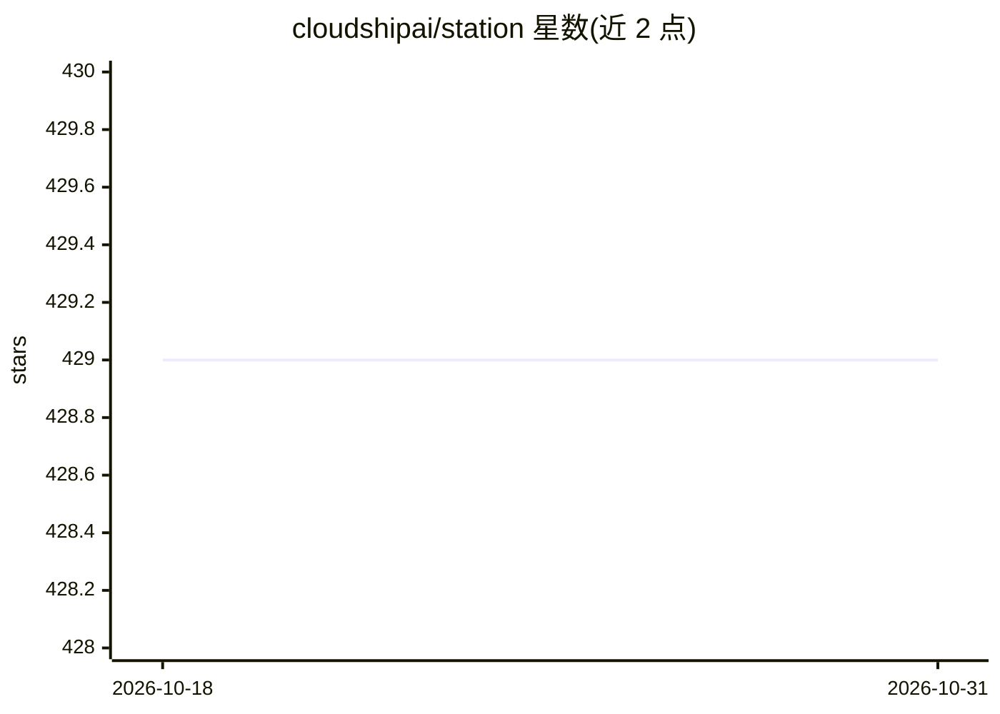

# cloudshipai/station

⭐ 429 · Go · Apache-2.0 · 推送 2026-01-27 · [GitHub](https://github.com/cloudshipai/station) · [官网](https://www.cloudshipai.com/station) · 组织维护

**自托管的多 Agent 编排与部署平台，供团队在自有基础设施上运行 Agent 团队**

用 Go 编写的开源 AI Agent 编排平台：通过 41+ 个 MCP 工具在 AI 助手中创建、执行、评测与调度多 Agent 团队；Agent 以 GenKit dotprompt 格式的 .prompt 文件定义，支持 Git 版本管理与一条命令部署（stn deploy）。内置 LLM-as-judge 自动评测、Jaeger 分布式追踪、Faker 模拟数据系统，以及 Web UI 配置界面。支持 CloudShip AI、OpenAI、Gemini、Anthropic API Key 四种提供方认证；Anthropic OAuth 认证路径已标记弃用不可用。面向需要自托管部署 Agent 的开发团队，需 Docker 运行。

## 筛选速览

| 维度 | 判定 | 备注 |
|---|---|---|
| AI 角色 | `ai-ecosystem` | LLM/agent 周边工具 |
| 许可风险 | `permissive` | Apache-2.0 |
| 部署形态 | `self-host` | docker 或自建部署 |
| 模型依赖 | locked-api |  |
| 硬件要求 | — | 无带数字的原话,不猜 |
| 安装摩擦 | `low` | 无编译、无系统依赖或容器化 |
| 成熟度 | — | 结构信号不足 |

## 能力要点

- 41+ 个 MCP 工具覆盖 Agent 管理、执行、评测、调度等 8 类操作
- Agent 以 .prompt 文件定义，Git 版本管理与 stn deploy 一键部署
- 内置 LLM-as-judge 评测与 Jaeger 分布式追踪
- Faker 系统生成模拟数据，无生产凭证即可开发测试

## 适用场景

- 在自有基础设施上构建和部署多 Agent 协作团队
- 用 MCP 客户端（Claude Code/Cursor/OpenCode）以自然语言管理 Agent
- 对 Agent 团队跑自动化评测与执行追踪

## 场景标签

`多智能体` `Agent 框架` `模型评测` · 领域:Agent 开发

## 证据(README 行号)

> L3: # Station - AI Agent Orchestration Platform
> L19: - ✅ **One-Command Deploy** - Push to production with `stn deploy`
> L322: **Station is driven entirely through MCP tools in your AI assistant.** Natural language requests use 41+ available

## 星数曲线

2026-10-18 429 → 2026-10-31 429（+0）

---
*卡片 v1 · prompt 1.4 · 生成 2026-10-21 · 置信度 high · 依据 README sha `bee3554be523` · [字段定义](../../DATASET.md)*
