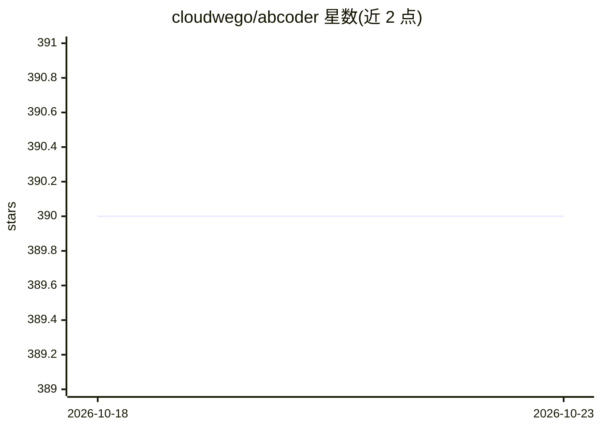

# cloudwego/abcoder

⭐ 390 · Go · Apache-2.0 · 推送 2026-08-31 · [GitHub](https://github.com/cloudwego/abcoder) · 组织维护 · 中文 README

**面向 LLM 的代码处理框架：UniAST 与本地 Code-RAG MCP 工具**

Cloudwego 维护的 AI 代码处理框架，核心是语言无关的通用抽象语法树 UniAST：General Parser 将任意语言代码解析为 UniAST，General Writer 将其转回代码；Code-RAG 以 MCP 工具形式在本地帮助 LLM 精确理解代码仓库，同时支持工作区内外的第三方库。提供与 Claude Code 的深度集成（init-spec 命令、斜杠命令与 hooks 分析链），也可作为独立 MCP server 或命令行 Agent（WIP）使用。Go 语言解析/写回均已支持，Rust/C/Python/JS/TS/Java 仅支持解析。

## 筛选速览

| 维度 | 判定 | 备注 |
|---|---|---|
| AI 角色 | `ai-ecosystem` | LLM/agent 周边工具 |
| 许可风险 | `permissive` | Apache-2.0 |
| 部署形态 | `library` | 以包/库形式分发 |
| 模型依赖 | local-ok | 支持本地模型 |
| 硬件要求 | — | 无带数字的原话,不猜 |
| 安装摩擦 | `low` | 无编译、无系统依赖或容器化 |
| 成熟度 | `idea` | |

## 能力要点

- UniAST：语言无关、面向 AI 的代码信息规范
- Code-RAG MCP 工具，本地解析并检索代码仓库，含工作区外第三方库
- Claude Code 深度集成：schedule/task/recheck 斜杠命令与 4 层 AST 分析链
- 可作命令行 Agent 运行（WIP，目前仅支持代码分析）

## 适用场景

- 为 AI 编程助手提供精确、本地的代码仓库上下文
- 通过 Claude Code 按 AST 驱动流程拆解并执行编码任务
- 把仓库解析为 UniAST JSON，构建代码审查/翻译/优化类应用

## 场景标签

`RAG` · 领域:知识与检索

## 证据(README 行号)

> L6: ABCoder, an AI-oriented Code-processing **Framework**, is designed to enhance and extend the coding context for Larg
> L16: - **Code-Retrieval-Augmented-Generation (Code-RAG)**, provides a set of MCP tools to help the LLM understand code r

## 星数曲线

2026-10-18 390 → 2026-10-23 390（+0）

---
*卡片 v1 · prompt 1.4 · 生成 2026-10-21 · 置信度 high · 依据 README sha `074e98bfcc33` · [字段定义](../../DATASET.md)*
