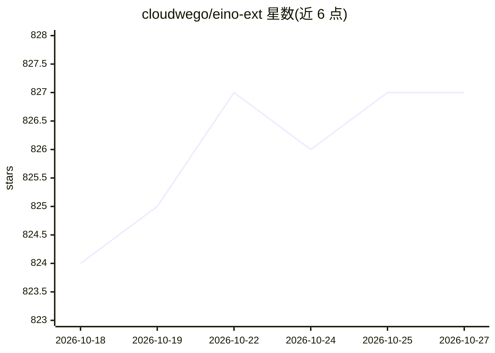

# cloudwego/eino-ext

⭐ 827 · Go · Apache-2.0 · 推送 2026-10-26 · [GitHub](https://github.com/cloudwego/eino-ext) · [官网](https://www.cloudwego.io/zh/docs/eino/core_modules/components/) · 组织维护 · 中文 README

**Eino LLM 框架的官方扩展集合：组件实现、回调、DevOps 工具**

CloudWeGo（字节跳动）维护的 Eino 框架扩展仓库，收录 Eino 各组件类型的官方实现：ChatModel（OpenAI、Claude、Gemini、Ark、Ollama 等）、Tool、Retriever、Document Loader、Embedding 等，以及实现 CallbackHandler 接口的回调处理器（如 Langfuse tracing）和包含可视化调试、UI 图编辑的 IDE 插件等 DevOps 工具。供使用 Eino 框架构建 LLM 应用的开发者接入各类模型与外部服务，采用 Apache-2.0 许可。README 未给出具体安装命令，需查阅 Eino 生态文档。

## 筛选速览

| 维度 | 判定 | 备注 |
|---|---|---|
| AI 角色 | `ai-ecosystem` | LLM/agent 周边工具 |
| 许可风险 | `permissive` | Apache-2.0 |
| 部署形态 | `None` |  |
| 模型依赖 | local-ok | 支持本地模型 |
| 硬件要求 | — | 无带数字的原话,不猜 |
| 安装摩擦 | `low` | 无编译、无系统依赖或容器化 |
| 成熟度 | — | 结构信号不足 |

## 能力要点

- 覆盖 ChatModel/Tool/Retriever/Embedding 等 9 类组件的官方实现
- ChatModel 支持 OpenAI、Claude、Gemini、Ark、Ollama 等多种模型
- Langfuse tracing 等回调处理器
- 含可视化调试与 UI 图编辑的 IDE 插件

## 适用场景

- 为 Eino 应用接入 OpenAI/Claude/Ollama 等模型
- 为 Eino 组件接入 ElasticSearch、S3 等外部服务
- 用 Langfuse 回调做 Eino 应用的链路追踪

## 场景标签

`Agent 框架` · 领域:Agent 开发

## 证据(README 行号)

> L7: The EinoExt project hosts various extensions for the Eino framework. Eino framework is a powerful and flexible frame
> L13: |ChatModel|OpenAI, Claude, Gemini, Ark, Ollama...|
> L27: - **callback handlers**: official callback handlers implementing Eino's CallbackHandler interface, such as Langfuse

## 星数曲线

2026-10-18 824 → 2026-10-27 827（+3）

---
*卡片 v1 · prompt 1.4 · 生成 2026-10-21 · 置信度 high · 依据 README sha `9e9274e007b1` · [字段定义](../../DATASET.md)*
