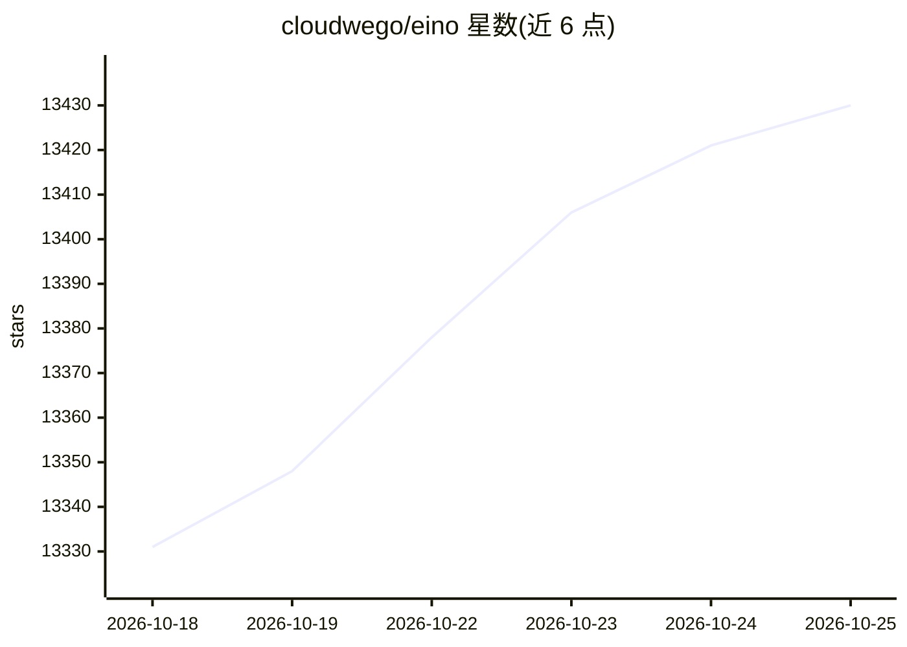

# cloudwego/eino

⭐ 13,440 · Go · Apache-2.0 · 推送 2026-10-21 · [GitHub](https://github.com/cloudwego/eino) · [官网](https://www.cloudwego.io/docs/eino/) · 组织维护 · 中文 README

**Go 语言的 LLM/AI 应用开发框架**

Eino 是面向 Golang 的 LLM 应用开发框架，设计上参照 LangChain、Google ADK 等开源框架并遵循 Go 语言惯例。核心提供：可复用组件抽象（ChatModel、Tool、Retriever、ChatTemplate 等，官方实现含 OpenAI、Ollama 等）、Agent 开发工具包 ADK（工具调用、多 Agent 协作、人机协同的中断/恢复、编排为图与工作流）、全链路流式处理与回调切面（日志/追踪/指标注入）。框架由本仓库与 EinoExt、Eino Devops、EinoExamples 四部分组成，依赖 Go 1.18+，采用 Apache-2.0 许可。

## 筛选速览

| 维度 | 判定 | 备注 |
|---|---|---|
| AI 角色 | `ai-native` | 本体是模型或模型工具 |
| 许可风险 | `permissive` | Apache-2.0 |
| 部署形态 | `None` |  |
| 模型依赖 | local-ok | 支持本地模型 |
| 硬件要求 | — | 无带数字的原话,不猜 |
| 安装摩擦 | `low` | 无编译、无系统依赖或容器化 |
| 成熟度 | — | 结构信号不足 |

## 动量与使用信号

- 维护:`active` — 距上次 push 2.2 天,年发版 100,41 位贡献者
- 涨星:近 1 天 **+7**(自 20261016 起算)
- 安装:github 包 `release-assets` 月下载无数据
- 平台:— · 协议:OLLAMA

## 能力要点

- 组件抽象带官方实现（OpenAI、Claude、Gemini、Ark、Ollama、Elasticsearch 等）
- ADK 支持工具调用、多 Agent 协作与人机协同的中断/恢复
- compose 将组件编排为图/工作流，可作为工具暴露给 Agent
- 编排全程自动处理流式拼接、合并与复制

## 适用场景

- 用 Go 构建基于 LLM 的应用与 Agent 服务
- 需要精确控制执行流程的领域工作流与 LLM 组合
- 搭建需要人机协同审批、可从检查点恢复的 Agent 流程

## 场景标签

`Agent 框架` `多智能体` `RAG` · 领域:Agent 开发

## 证据(README 行号)

> L17: **Eino['aino]** is an LLM application development framework in Golang. It draws from LangChain, Google ADK, and oth
> L20: - **Components**: reusable building blocks like `ChatModel`, `Tool`, `Retriever`, and `ChatTemplate`, with official
> L21: - **Agent Development Kit (ADK)**: build AI agents with tool use, multi-agent coordination, context management, int

## 星数曲线

2026-10-18 13,331 → 2026-10-25 13,430（+99）

---
*卡片 v1 · prompt 1.4 · 生成 2026-10-18 · 置信度 high · 依据 README sha `46282335117d` · [字段定义](../../DATASET.md)*
