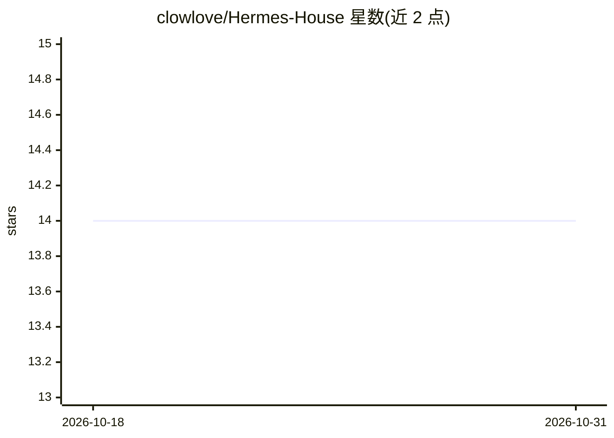

# clowlove/Hermes-House

⭐ 14 · HTML · NOASSERTION · 推送 2026-10-29 · [GitHub](https://github.com/clowlove/Hermes-House) · [官网](https://clowlove.github.io/Hermes-House/) · 个人维护 · 中文 README

**自进化多 Agent 系统：持续学习并自动扩展技能库**

Hermès Agent 是一个自进化多 Agent 系统，包含核心记忆系统（MEMORY.md/tasks.md/每日日志）、51+ 技能库（开发工具、数据分析、AI/ML、网络代理、通讯集成、业务运营等类别）与 TrendRadar 等监控面板。技能可自动生成扩展，通过 GitHub Actions 定时任务执行趋势监控、PR 自动审查、内容创作等自动化工作流。安装方式为 git clone 源码后配置 .env 并用 hermes CLI 或 python agent/main.py 启动，需配置 API key。路线图显示自我改进系统与自主学习引擎仍在规划中。

## 筛选速览

| 维度 | 判定 | 备注 |
|---|---|---|
| AI 角色 | `ai-ecosystem` | LLM/agent 周边工具 |
| 许可风险 | `none` | NOASSERTION |
| 部署形态 | `None` |  |
| 模型依赖 | — | README 未给出锁定关系 |
| 硬件要求 | — | 无带数字的原话,不猜 |
| 安装摩擦 | `low` | 无编译、无系统依赖或容器化 |
| 成熟度 | — | 结构信号不足 |

## 能力要点

- 51+ 技能库覆盖开发工具、数据分析、AI/ML 等 6 大类别
- 文件式记忆系统（核心记忆/任务追踪/每日日志）
- @agent.cron 定时任务与 @agent.task 任务装饰器
- TrendRadar 实时趋势监控等 3 个监控面板

## 适用场景

- 通过定时任务自动化处理 GitHub PR 与代码审查
- 自动化趋势监控与内容生成发布
- 搭建可自动扩展技能的个人 Agent 工作流

## 场景标签

`多智能体` `工作流自动化` `代码审查` · 领域:Agent 开发

## 证据(README 行号)

> L14: **Hermès Agent** 是一个自进化多 Agent 系统：
> L31: ### 🤖 多 Agent 架构

## 星数曲线

2026-10-18 14 → 2026-10-31 14（+0）

---
*卡片 v1 · prompt 1.4 · 生成 2026-10-31 · 置信度 mid · 依据 README sha `5e3cf3f477fa` · [字段定义](../../DATASET.md)*
