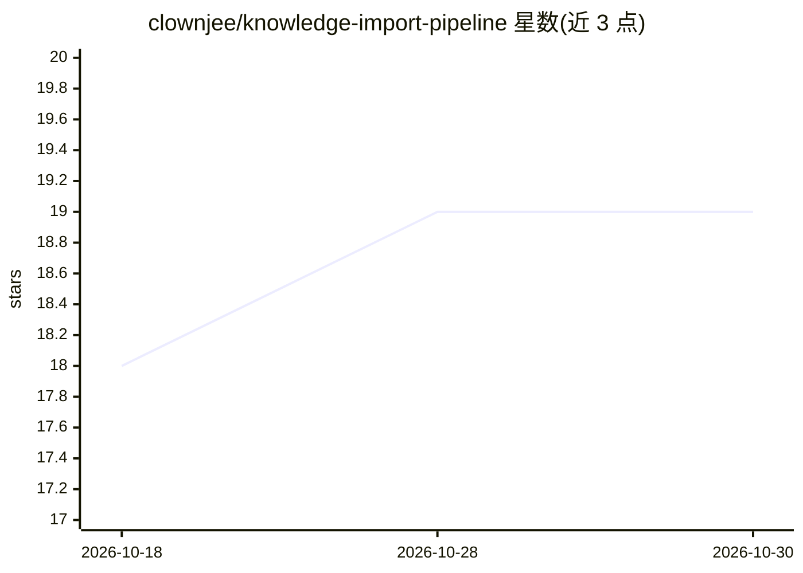

# clownjee/knowledge-import-pipeline

⭐ 19 · Java · Apache-2.0 · 推送 2026-08-27 · [GitHub](https://github.com/clownjee/knowledge-import-pipeline) · [官网](https://clownjee.top:1443) · 个人维护 · 中文 README

**面向义务教育教材的 AI 知识抽取与知识图谱平台**

从教材 PDF 中异步解析教材信息、目录与知识点，使用 Embedding 向量召回候选知识点后由 LLM 判断直接前置关系、置信度及原因，构建同学科跨年级的知识依赖网络，并通过 Vue 3 交互式界面按学科、年级、置信度浏览与搜索。同时提供 MCP 只读查询服务（5 个工具），供 AI 客户端查询学科、教材、课时与知识点上下游关系。LLM/视觉/Embedding 模型均通过环境变量接入 OpenAI-compatible API，向量字段固定为 1024 维。部署依赖 Docker Compose、PostgreSQL+pgvector、Redis、TLS 证书与外部 OpenDataLoader PDF 服务；项目声明为非官方，不提供教材原文内容。

## 筛选速览

| 维度 | 判定 | 备注 |
|---|---|---|
| AI 角色 | `ai-native` | 本体是模型或模型工具 |
| 许可风险 | `permissive` | Apache-2.0 |
| 部署形态 | `self-host` | docker 或自建部署 |
| 模型依赖 | — | README 未给出锁定关系 |
| 硬件要求 | — | 无带数字的原话,不猜 |
| 安装摩擦 | `low` | 无编译、无系统依赖或容器化 |
| 成熟度 | — | 结构信号不足 |

## 能力要点

- PDF 上传后异步完成教材识别、目录解析与知识点抽取，逐步记录任务状态
- Embedding 召回候选 + LLM 判定直接前置关系、置信度与原因
- 交互式知识图谱可视化：搜索、缩放、上下游路径聚焦
- MCP 只读查询服务，提供 5 个学科/教材/课时/知识点查询工具

## 适用场景

- 教师或学生梳理某知识点在跨教材体系中的前置与后续依赖
- AI 客户端通过 MCP 按教材和课时生成分学科复习上下文
- 教研场景下构建和维护义务教育阶段学科知识图谱

## 场景标签

`知识图谱` `文档解析` · 领域:知识与检索

## 证据(README 行号)

> L21: - **知识依赖构建**：使用 Embedding 向量召回候选知识点，再由大语言模型判断直接前置关系、置信度及原因。
> L24: - **MCP 查询服务**：为 AI 客户端提供只读工具，可查询学科、教材、课时、知识点及其直接前置与后续关系。

## 星数曲线

2026-10-18 18 → 2026-10-30 19（+1）

---
*卡片 v1 · prompt 1.4 · 生成 2026-10-28 · 置信度 high · 依据 README sha `b3a112001229` · [字段定义](../../DATASET.md)*
