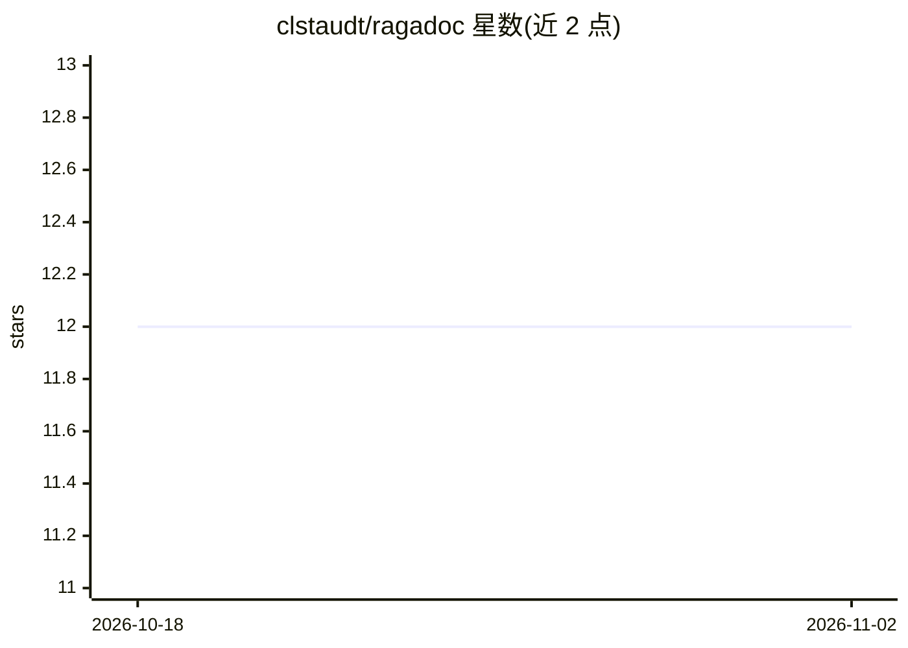

# clstaudt/ragadoc

⭐ 12 · Python · GPL-3.0 · 推送 2026-04-24 · [GitHub](https://github.com/clstaudt/ragadoc) · 个人维护

**本地模型驱动的 PDF 问答应用：带引用并在原文中高亮**

基于 Streamlit 的文档问答应用：上传 PDF 后自动提取、分块、向量化，用户以自然语言提问，回答附带引用并在 PDF 原文中高亮对应段落。全部模型通过 Ollama 本地运行，文档不离开本机；技术栈含 ChromaDB、PyMuPDF4LLM。支持 uv 源码运行或 Docker 部署，可调 chunk 大小、相似度阈值等 RAG 参数。项目自述处于早期概念验证阶段，可能有功能不完整与破坏性变更。

## 筛选速览

| 维度 | 判定 | 备注 |
|---|---|---|
| AI 角色 | `ai-native` | 本体是模型或模型工具 |
| 许可风险 | `viral` | GPL-3.0 |
| 部署形态 | `self-host` | docker 或自建部署 |
| 模型依赖 | local-ok | 支持本地模型 |
| 硬件要求 | — | 无带数字的原话,不猜 |
| 安装摩擦 | `low` | 无编译、无系统依赖或容器化 |
| 成熟度 | `idea` | |

## 能力要点

- RAG 问答回答附带具体引用
- 引用段落自动在 PDF 中高亮
- 仅使用本地 Ollama 模型，文档不上传
- Expert Mode 可调 chunk 大小、相似度阈值、检索数量

## 适用场景

- 对本地 PDF 文档提问并获得带出处的回答
- 隐私敏感场景下离线进行文档问答
- 需要核对答案在原文位置的阅读与查证工作

## 场景标签

`文档问答` · 领域:知识与检索

## 证据(README 行号)

> L5:  **AI document assistant that answers questions about your PDFs with citations and highlights.**
> L11: - 🤖 **AI Document Q&A** - Natural language questions about your PDFs
> L14: - 🔒 **Complete Privacy** - Local AI models only, documents never leave your computer

## 星数曲线

2026-10-18 12 → 2026-11-02 12（+0）

---
*卡片 v1 · prompt 1.4 · 生成 2026-11-01 · 置信度 high · 依据 README sha `c1b1a1a7b640` · [字段定义](../../DATASET.md)*
