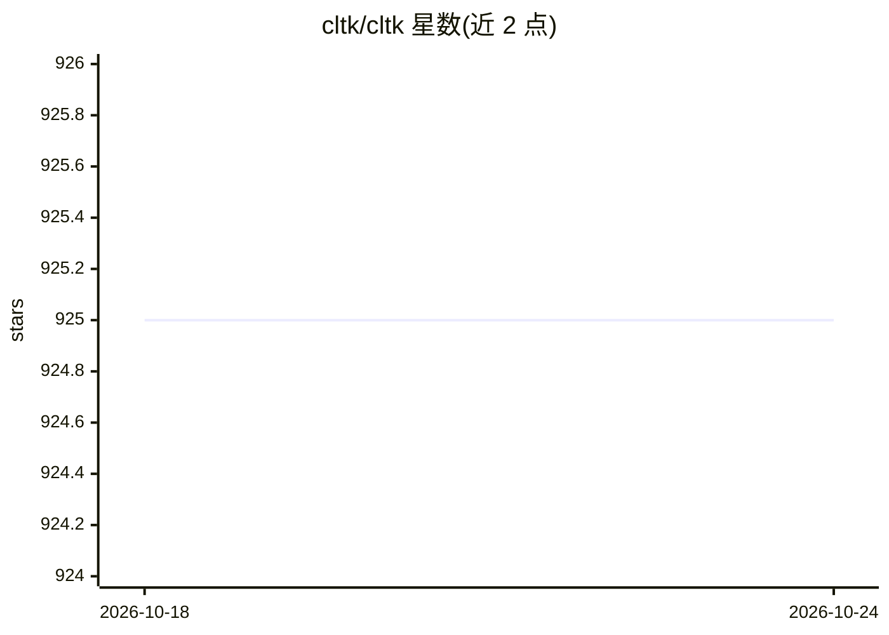

# cltk/cltk

⭐ 926 · Python · MIT · 推送 2026-08-01 · [GitHub](https://github.com/cltk/cltk) · [官网](http://cltk.org) · 组织维护

**面向古典语言的 Python NLP 库（拉丁语、古希腊语等）**

为前现代语言（拉丁语、古希腊语等古典语言）提供自然语言处理的 Python 库，功能类似 NLTK/Stanza 在古典文本上的应用。1.0 版本起支持可选后端：OpenAI 云端 GenAI 标注、Stanford Stanza 判别式后端、以及通过 Ollama 运行本地 LLM（默认 llama3.1:8b，可指定其他模型）。Pre-1.0 旧版本仍以 v0.1.x 分支和 pip 安装方式提供，有 ACL 2021 论文可引用。

## 筛选速览

| 维度 | 判定 | 备注 |
|---|---|---|
| AI 角色 | `ai-native` | 本体是模型或模型工具 |
| 许可风险 | `permissive` | MIT |
| 部署形态 | `library` | 以包/库形式分发 |
| 模型依赖 | local-ok | 支持本地模型 |
| 硬件要求 | — | 无带数字的原话,不猜 |
| 安装摩擦 | `low` | 无编译、无系统依赖或容器化 |
| 成熟度 | — | 结构信号不足 |

## 能力要点

- 针对前现代语言（古典语言）的 NLP 处理
- 可选 OpenAI / Stanza / Ollama 三种后端
- Ollama 本地 LLM 后端默认 llama3.1:8b，可传 model 参数换模型
- 提供 ACL 2021 系统演示论文与 MIT 许可

## 适用场景

- 我对拉丁语、古希腊语文本做分词、词形还原等 NLP 分析
- 我在本地用 Ollama 跑古典语言的 LLM 标注
- 我做数字人文/历史语言学研究时需要现成的处理工具

## 场景标签

 · 领域:NLP/数字人文（古典语言）

## 证据(README 行号)

> L1: The Classical Language Toolkit (CLTK) is a Python library offering natural language processing (NLP) for pre-modern 
> L76: Johnson, Kyle P., Patrick J. Burns, John Stewart, Todd Cook, Clément Besnier, and William J. B. Mattingly. "The Cla

## 星数曲线

2026-10-18 925 → 2026-10-24 925（+0）

---
*卡片 v1 · prompt 1.4 · 生成 2026-10-21 · 置信度 high · 依据 README sha `86c491621315` · [字段定义](../../DATASET.md)*
