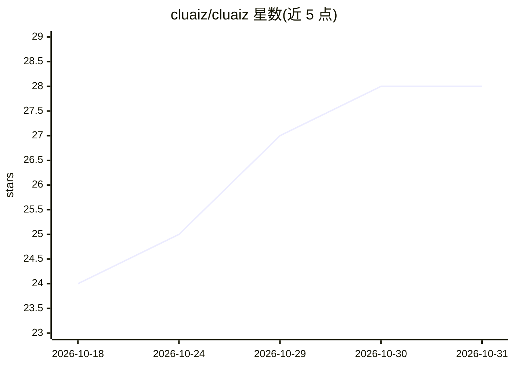

# cluaiz/cluaiz

⭐ 28 · Rust · Apache-2.0 · 推送 2026-10-30 · [GitHub](https://github.com/cluaiz/cluaiz) · [官网](https://cluaiz.com) · 个人维护

**Rust 本地 AI 运行时引擎：本地推理与 agent 工作流编排**

用 Rust 编写的统一原生运行时引擎与编排器，面向边缘设备与本地部署：以 llama.cpp 执行 GGUF 文本模型、集成 ONNX Runtime 处理视觉/嵌入/音频等多模态任务，支持 CPU/GPU 混合加载与 BitNet 1-bit/1.58-bit 量化编译期注入。通过单一 CEP 协议（JSON-RPC 2.0）经 HTTP、MCP 与进程内 C 库访问，支持 WASM/原生插件、技能系统、KV-Cache 前缀复用与内存治理。提供跨平台安装脚本、TUI 面板与 OpenAI 兼容 API 服务。项目声明处于 Pre-Alpha 验证阶段，将出现重大变更。

## 筛选速览

| 维度 | 判定 | 备注 |
|---|---|---|
| AI 角色 | `ai-ecosystem` | LLM/agent 周边工具 |
| 许可风险 | `permissive` | Apache-2.0 |
| 部署形态 | `None` |  |
| 模型依赖 | local-ok | 支持本地模型 |
| 硬件要求 | — | 无带数字的原话,不猜 |
| 安装摩擦 | `medium` | 含编译或系统依赖之一 |
| 成熟度 | `idea` | |

## 能力要点

- llama.cpp + ONNX Runtime 双引擎，文本与多模态并行执行
- CEP 单一 JSON-RPC 2.0 协议：HTTP / MCP / 进程内 C 库三种通道
- BitNet 1-bit/1.58-bit 量化模型的编译期原生执行
- KV-Cache 前缀复用、生成中暂停恢复与 Memory Governor 防 OOM

## 适用场景

- 在本地运行 GGUF/ONNX 模型并通过 OpenAI 兼容 API 提供服务
- 用技能/插件/MCP 连接器扩展本地 agent 工作流
- 通过 TUI 仪表盘与 Developer Hub 管理、测试本地推理引擎

## 场景标签

`推理引擎` `Agent 框架` · 领域:Agent 开发

## 证据(README 行号)

> L23:  Cluaiz is a fast, easy-to-use, unified native runtime engine and orchestrator built in Rust. Optimized for edge de
> L29: - **Dual-Engine Orchestration and Multimodal Integration**: Cluaiz is not a superficial wrapper; it natively orches

## 星数曲线

2026-10-18 24 → 2026-10-31 28（+4）

---
*卡片 v1 · prompt 1.4 · 生成 2026-10-27 · 置信度 high · 依据 README sha `7b716ba85e02` · [字段定义](../../DATASET.md)*
