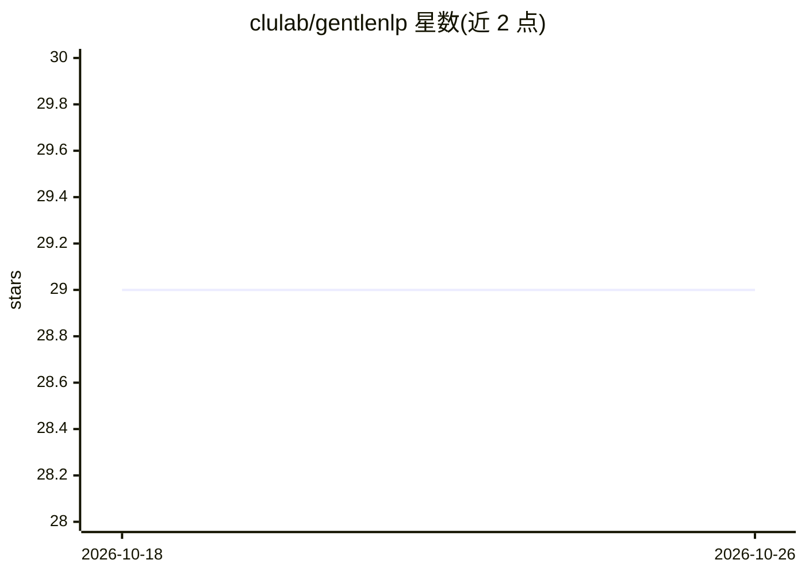

# clulab/gentlenlp

⭐ 29 · Jupyter Notebook · Apache-2.0 · 推送 2026-09-08 · [GitHub](https://github.com/clulab/gentlenlp) · 组织维护

**《Deep Learning for NLP》配套代码与数据集仓库**

由 clulab（亚利桑那大学团队）维护的教材配套仓库，收录 Mihai Surdeanu 与 Marco A. Valenzuela-Escárcega 所著《Deep Learning for Natural Language Processing: A Gentle Introduction》书中介绍的代码与数据，指向项目主页 http://clulab.github.io/gentlenlp/。README 未给出安装步骤、依赖清单或运行说明；仓库主题标签涵盖深度学习、机器学习与自然语言处理。

## 筛选速览

| 维度 | 判定 | 备注 |
|---|---|---|
| AI 角色 | `ai-knowledge` | 知识聚合/清单类 |
| 许可风险 | `permissive` | Apache-2.0 |
| 部署形态 | `None` |  |
| 模型依赖 | — | README 未给出锁定关系 |
| 硬件要求 | — | 无带数字的原话,不猜 |
| 安装摩擦 | `low` | 无编译、无系统依赖或容器化 |
| 成熟度 | — | 结构信号不足 |

## 能力要点

- 教材《Deep Learning for NLP: A Gentle Introduction》配套代码
- 附书中所用的数据

## 适用场景

- 随书学习深度学习 NLP 内容并运行书中示例
- 获取书中实验所用的数据

## 场景标签

`教程课程` · 领域:学习与行业

## 证据(README 行号)

> L1: # Deep Learning for Natural Language Processing: A Gentle Introduction
> L3: This repository contains the code and data introduced in the book *Deep Learning for Natural Language Processing: A 

## 星数曲线

2026-10-18 29 → 2026-10-26 29（+0）

---
*卡片 v1 · prompt 1.4 · 生成 2026-10-26 · 置信度 mid · 依据 README sha `114b053b5c98` · [字段定义](../../DATASET.md)*
