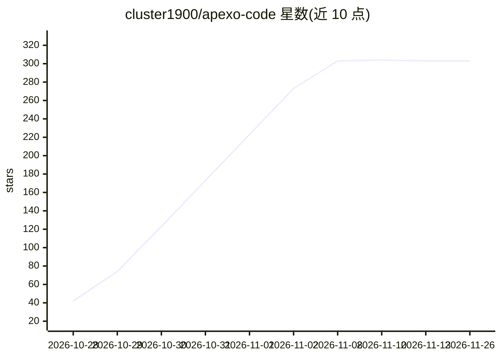

# cluster1900/apexo-code

⭐ 303 · TypeScript · MIT · 推送 2026-11-20 · [GitHub](https://github.com/cluster1900/apexo-code) · 个人维护

**开源通用编码 agent，提供终端/Web/桌面三端界面**

Apexo 是一个通用编码 agent，由本地 agent 运行时统一驱动终端 TUI、Web UI 与 Electron 桌面应用。核心机制包括自主目标（/goal）、多会话工作流（/workflow）、后台任务与子 agent 编排（/tasks）、跨会话持久项目记忆（/memory）、OS 级命令沙箱（seatbelt/bubblewrap）与生命周期钩子。认证在本地完成，模型请求直连所配置的 provider；桌面应用无自动更新器，需重新构建或安装新版以更新。

## 筛选速览

| 维度 | 判定 | 备注 |
|---|---|---|
| AI 角色 | `ai-ecosystem` | LLM/agent 周边工具 |
| 许可风险 | `permissive` | MIT |
| 部署形态 | `library` | 以包/库形式分发 |
| 模型依赖 | local-ok | 支持本地模型 |
| 硬件要求 | — | 无带数字的原话,不猜 |
| 安装摩擦 | `low` | 无编译、无系统依赖或容器化 |
| 成熟度 | — | 结构信号不足 |

## 能力要点

- 单本地运行时驱动 TUI、Web、桌面三种界面，共享会话历史
- 自主目标迭代（/goal）与多会话工作流（/workflow）
- OS 级命令沙箱（macOS seatbelt / Linux bubblewrap）
- 支持 Google Antigravity 与 xAI Grok 的本地 OAuth 登录复用

## 适用场景

- 在终端中以 TUI 方式运行编码 agent 处理项目任务
- 通过配置接入 OpenAI 兼容的本地或第三方模型端点
- 用持久记忆跨会话维护项目上下文
- 在后台运行定时任务与子 agent 协调会话

## 场景标签

`编码 Agent` · 领域:编码与开发

## 证据(README 行号)

> L11: Apexo is a **general-purpose coding agent** with a unified terminal UI (TUI), web UI, and Electron desktop app powe
> L17: - **Universal multi-provider & OpenAI-compatible runtime.** Connect OpenAI, Anthropic (Claude), MiniMax, DeepSeek, 

## 星数曲线

2026-10-28 42 → 2026-11-26 303（+261）

---
*卡片 v1 · prompt 1.4 · 生成 2026-11-25 · 置信度 high · 依据 README sha `127d98fbe0bc` · [字段定义](../../DATASET.md)*
