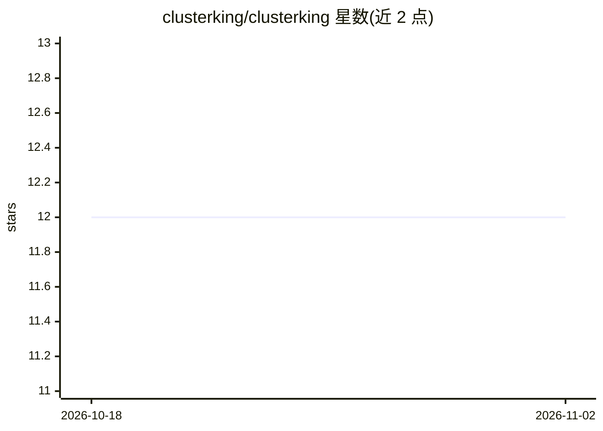

# clusterking/clusterking

⭐ 12 · Python · MIT · 推送 2026-10-05 · [GitHub](https://github.com/clusterking/clusterking) · [官网](http://clusterking.rtfd.io/) · 组织维护

**高能物理中直方图集合的聚类与基准点选取框架**

Python 包，提供对直方图（或其他高维数据）集合进行聚类并从每个簇中选取代表性基准点的工作流，聚焦高能物理唯象学应用。工作流分三步：Scanning 为参数空间各点生成运动学分布，Clustering 按相似度度量（如 euclidean、chi2）做层次聚类，Benchmarking 为每簇选出最代表性参数点。内置 WilsonScanner 与 flavio 配合扫描 Wilson 系数空间，支持多种聚类与分布可视化。以 pip 安装，附 Jupyter notebook 示例与在线 Binder 运行方式。

## 筛选速览

| 维度 | 判定 | 备注 |
|---|---|---|
| AI 角色 | `ai-native` | 本体是模型或模型工具 |
| 许可风险 | `permissive` | MIT |
| 部署形态 | `library` | 以包/库形式分发 |
| 模型依赖 | — | README 未给出锁定关系 |
| 硬件要求 | — | 无带数字的原话,不猜 |
| 安装摩擦 | `low` | 无编译、无系统依赖或容器化 |
| 成熟度 | — | 结构信号不足 |

## 能力要点

- 三步工作流：扫描生成运动学分布、聚类、选取代表性基准点
- 内置 WilsonScanner 扫描 Wilson 系数空间并与 flavio 配合
- 层次聚类支持 euclidean/chi2 等度量与可配置截断值
- 提供散点图、2D 填充图、箱线图等聚类与分布可视化

## 适用场景

- 对新物理模型参数空间按运动学分布相似度聚类并选基准点
- 以少量代表性参数点报告排除限与测量结果
- 对任意直方图或高维数据集合做聚类与代表点选取

## 场景标签

 · 领域:高能物理/机器学习

## 证据(README 行号)

> L55: This package provides a flexible yet easy to use framework to cluster sets of
> L57: representing each cluster. The package particularly focuses on use cases in
> L199:  c = ck.cluster.HierarchyCluster() # Initialize worker class

## 星数曲线

2026-10-18 12 → 2026-11-02 12（+0）

---
*卡片 v1 · prompt 1.4 · 生成 2026-11-01 · 置信度 high · 依据 README sha `d08463f9e240` · [字段定义](../../DATASET.md)*
